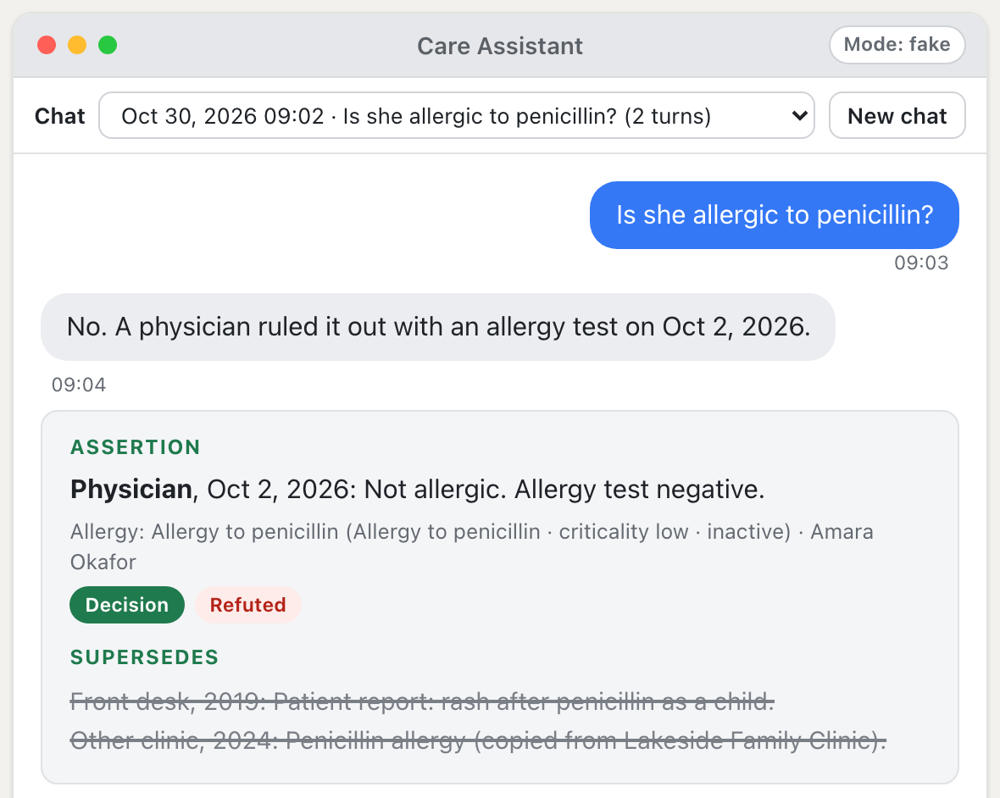
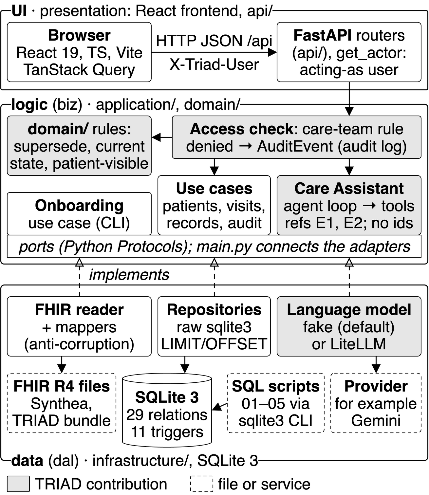

<h1>
  
  TRIAD
</h1>

**Trusted RDF Interoperable Agent Data**

CSC 501; Algorithms and Data Models (Fall 2026), Prof. Hossein Fani
University of Victoria

TRIAD is a data model for clinical records that many people make and change over time.
Each clinical fact is an assertion with an author and a source. When a fact changes, a new assertion
supersedes the old one, and the old one stays. So the current state of a record is the result of a
traversal (follow the Supersedes links to the head), not of a search. The clinical entities follow the
HL7 FHIR R4 standard. The Milestone 4 prototype is a hospital web app on a relational database (SQLite)
with a Care Assistant chat that answers from the current assertions and shows what they supersede.

## Illustrative sample

The 3MT slide asks: "Is she allergic to penicillin?" The chart of Patient A has three assertions about
one allergy: a patient report at the front desk (2019), a copy from another clinic (2024), and an allergy
test by a physician (2026) that refutes the allergy. The Care Assistant answers from the current assertion
and shows the two old assertions with a line through them:



The query behind the answer follows the Supersedes chain (query Q2 of
[`dml/03_select_queries.sql`](src/backend/models/relational/sql/dml/03_select_queries.sql)).

## Quickstart

You need:

- macOS or Linux (on Windows, use WSL2);
- [uv](https://docs.astral.sh/uv/) (it gets Python 3.12 itself), or Python 3.12 if uv is not installed;
- Node.js 20.19 or later (in version 22: 22.12 or later) with npm.

The `sqlite3` command (SQLite 3.43 or later) is optional: only the plain SQL scripts use it. All data is synthetic.
From the root folder of the repository:

```sh
./src/scripts/quickstart.sh
```

The script checks the prerequisites, makes the Python environment, installs the pinned packages, builds the
frontend, builds the database from the FHIR data, runs the fast tests, and then serves the app on
http://127.0.0.1:8000. The first run takes about 15 s with a fast network (it downloads about 50 MB), or
some minutes with a slow network. A second run skips the work that is done and takes a few seconds.
To use another port: `PORT=9000 ./src/scripts/quickstart.sh`.

Open http://127.0.0.1:8000 and select **Demo guide** in the top bar. The guide follows the
hospital-visit journey of [`USER_FLOWS.md`](USER_FLOWS.md), Use case 0 to Use case 9. Each step of a
use case has an **Act as** button that sets the user and opens the page. Ctrl+C stops the server.
To start again with a new database, run `./src/scripts/quickstart.sh --reset-db`.

### Development mode

```sh
./src/scripts/dev.sh              # the API with hot reload on port 8000 and the app (Vite) on port 5173
./src/scripts/dev.sh --reset-db   # the same, but build the database again first
PORT=9000 VITE_PORT=5174 ./src/scripts/dev.sh   # other ports
```

Open http://127.0.0.1:5173. One Ctrl+C stops the two servers. To install the packages without a script:

```sh
uv venv --python 3.12 .venv
uv pip install --python .venv/bin/python -r requirements.txt
npm --prefix src/frontend ci
```

### Settings and the LLM mode (optional)

The first run of a script makes two settings files from their `.env.example` files. Git ignores them.

- `src/backend/.env`: the backend settings and the API keys.
- `src/frontend/.env`: the frontend settings. Each `VITE_` value in it is public, so never put a key there.

The Care Assistant uses a fake language model by default. It needs no API key and no network.
To use a real model (Gemini has a free tier):

```sh
uv pip install --python .venv/bin/python -r requirements-llm.txt
# Get a key at https://aistudio.google.com/apikey. Then, in src/backend/.env, set:
#     TRIAD_LLM=llm
#     GEMINI_API_KEY=<your key>
./src/scripts/dev.sh                                        # start it again after each change to a .env file
```

If the key is missing, the server prints what is missing and uses the fake model.
By default, the backend logs each SQL statement of a request with its time (`TRIAD_SQL_LOG`), and it uses
the clock of the computer (`TRIAD_NOW`). See [`src/backend/README.md`](src/backend/README.md#settings-and-secrets-env)
for all settings.

## Architecture



Each request goes through the access check before a use case. Each adapter of the data layer implements a port
of the logic layer (dashed arrows). Grey marks the TRIAD contribution. The figure is also in
[`doc/architecture.pdf`](doc/architecture.pdf); `src/scripts/build_architecture.py` makes it.

The backend follows Clean Architecture. The table gives the names of the course manual and the folders.

| Layer (manual) | Clean Architecture | Folders |
|---|---|---|
| UI | presentation | [`src/frontend/`](src/frontend/) (React, Vite, TypeScript) and [`src/backend/api/`](src/backend/api/) (FastAPI routers) |
| logic (biz) | use cases and domain | [`src/backend/application/`](src/backend/application/) (use cases, ports) and [`src/backend/domain/`](src/backend/domain/) (entities and rules) |
| data (dal) | adapters and the database | [`src/backend/infrastructure/`](src/backend/infrastructure/) (SQLite repositories, FHIR reader, language models) and [`src/backend/models/`](src/backend/models/) (ER diagram, relations, SQL) |

- **The dependency rule.** `api` → `application` → `domain`. `infrastructure` → the ports of `application`
  and `domain`. Only [`src/backend/main.py`](src/backend/main.py) (the composition root) knows the adapters.
- **The database.** SQLite 3 through the Python `sqlite3` module, with raw SQL and no ORM.
  Each list endpoint gives pages (`LIMIT ? OFFSET ?`). The API contract is [`doc/api.md`](doc/api.md).
- **The Care Assistant.** The same tools serve the fake model and the real model. Each tool is bound to the
  user and the patient of the request and runs one SQL query. The model gets references (`E1`, `E2`),
  never a database id, a patient name or a date of birth.

More information: [`src/backend/README.md`](src/backend/README.md) and [`src/frontend/README.md`](src/frontend/README.md).

## Data model

TRIAD records each clinical fact as an **Assertion**. A staff member issues a
**Message**, and the message contains one or more assertions. Each assertion
is about one **ClinicalEntry**, and each entry belongs to one **Visit** of a
**Patient**. A unary **Supersedes** relationship records what replaced what.
The current fact is the assertion that nothing supersedes.

The diagram is a tree: there is exactly one path between any two entity sets.
Grey marks the TRIAD contribution (authorship, revision and the agent layer).


- Notes on the model (notation, design rules, changes from Milestone 2, FHIR R4
  alignment): [`src/backend/models/er/README.md`](src/backend/models/er/README.md)
- The diagram as PDF: [`src/backend/models/er/TRIAD_ERD.pdf`](src/backend/models/er/TRIAD_ERD.pdf)
- The relational schema (29 relations, 11 triggers): [`src/backend/models/relational/`](src/backend/models/relational/)
- The user flows of the prototype: [`USER_FLOWS.md`](USER_FLOWS.md)
- The Milestone 2 draft stays in [`assets/designing_erd/`](assets/designing_erd/).

## Sample data

The sample data has 113 patients, 5,090 visits, 57,020 clinical entries and 57,022 assertions.
We onboarded it from the Synthea FHIR R4 sample (US Core, commit `84f5980`) and one curated FHIR R4 bundle,
through our FHIR onboarding pipeline. Every row keeps the FHIR identifier of its source resource,
so the data stays FHIR compliant.

- The sources, their checksums and how to get them again: [`src/backend/data/raw/README.md`](src/backend/data/raw/README.md)
- The mapping from FHIR R4 to the relations: [`doc/fhir_mapping.md`](doc/fhir_mapping.md)
- `python src/backend/main.py ensure-db --reset-db` builds the database from the FHIR files again (about 3 s).

## DBMS and SQL scripts

The DBMS is SQLite 3.43 or later. The scripts run with the `sqlite3` command and need no Python:

```sh
cd src/backend/models/relational/sql
sqlite3 triad.db < ddl/01_create_tables.sql                   # the schema: 29 relations and 11 triggers
sqlite3 triad.db < dml/02_insert_seed.sql                     # the scenario data
sqlite3 -header -column triad.db < dml/03_select_queries.sql  # the queries Q1 to Q14
```

The scripts `04_update_delete.sql` and `05_constraint_violations.sql` change the data, so run them on a copy.
See [`src/backend/models/relational/sql/README.md`](src/backend/models/relational/sql/README.md).

## See the database in the browser

```sh
./src/scripts/dbview.sh
```

The script opens a read-only viewer of the database on http://127.0.0.1:8001 ([Datasette](https://datasette.io/)).
It installs the viewer the first time (`requirements-dbview.txt`) and builds the database if it is missing.

- **The tables.** Each of the 29 relations, with its rows in pages, filters, links that follow the foreign keys,
  and its `CREATE TABLE` statement.
- **The queries.** Q1 to Q14b of `dml/03_select_queries.sql`, and a box for other SELECT statements.
- **The schema.** Ready queries for the tables, the columns, the foreign keys, the 11 triggers and the indexes.

The viewer cannot change the data. The app can run at the same time: refresh a page to see the new rows.
The viewer shows all rows and does not use the access rules of the app, so use it only with synthetic data.
To use another port: `DBVIEW_PORT=8002 ./src/scripts/dbview.sh`.

## Reproduce the demo

- **By hand:** the Demo guide in the app (Use case 0 to Use case 9). [`USER_FLOWS.md`](USER_FLOWS.md) section 3
  gives each use case and its expected result.
- **Through the API:** `.venv/bin/python -m pytest -q src/backend/tests/integration/test_hospital_visit.py`
  walks the same journey and checks each expected result.
- **In the browser:** `npm --prefix src/frontend run e2e` runs the journey, the directory cases and the Demo guide
  with Playwright (17 tests, about 30 s). The tests build the frontend and start their own server on port 8123,
  with a new copy of the database, the fake model and a fixed demo time. On a new computer, run
  `npx --prefix src/frontend playwright install --only-shell chromium` one time first.
  `npm --prefix src/frontend run e2e:screens` also writes the screenshots in [`doc/screenshots/`](doc/screenshots/)
  again (the report uses them).
- **The same times as the screenshots:** set `TRIAD_NOW=2026-10-30T09:00:00-04:00` in `src/backend/.env` and
  build a new database (`--reset-db`).

### Other commands

```sh
.venv/bin/python -m pytest -q                               # the 422 backend tests (about 10 s)
.venv/bin/python -m pytest -q -m "not slow"                 # the fast tests only
npm --prefix src/frontend run build                         # type-check and build the frontend into src/frontend/dist/
npm --prefix src/frontend run check:demo                    # check the Demo guide and the logo
npm --prefix src/frontend run e2e                           # the Playwright tests (port 8123)
.venv/bin/python src/backend/main.py serve                  # serve the built app and the API on http://127.0.0.1:8000
.venv/bin/python src/backend/main.py ensure-db --reset-db   # build the database again from the FHIR data (about 3 s)
```

## Design choice: user switching instead of a login

The prototype has no login. This is a design choice, so that the demo and the tests are fast.

- **User switching.** The top bar selects the user type and the user. The frontend sends the user key
  in the header `X-Triad-User` with each request. Each step of the Demo guide has an **Act as** button.
  So one person can test all the use cases of all the user groups in a few minutes.
- **Authorization is real.** The backend checks each request against the permission rules of
  [`USER_FLOWS.md`](USER_FLOWS.md#2-permissions) section 2: the care-team rule, the role matrix and the
  patient-visible rule. A denied request gets 403. When the request is about a patient, the backend also
  writes an audit record (outcome "Denied"). A request with no user or an unknown user gets 401.
- **Authentication is not real.** The backend trusts the header, so any client can act as any user.
  Authorization is decoupled from authentication: the access rules need only an `Actor`, and one
  function makes the `Actor` (`get_actor` in [`src/backend/api/actor.py`](src/backend/api/actor.py)).
- **A real system adds a login.** For example, the single sign-on of the hospital with OpenID Connect,
  or SMART on FHIR. The server then takes the user from the verified token, not from a header that the
  client sets. Only `get_actor` changes. The user switcher is then removed, or kept only in a test build.
- **Synthetic data only.** For this reason, the prototype must hold only synthetic data.

## Repository layout

```
README.md, USER_FLOWS.md       this file; the user flows and the hospital-visit journey (Milestone 4)
CITATION.cff, LICENSE          how to cite TRIAD; the licence
requirements*.txt, pytest.ini  the pinned Python packages (-llm: the LLM mode; -dbview: the database viewer); the test settings
src/backend/                   the FastAPI backend: main.py, api/, application/, domain/, infrastructure/, tests/
src/backend/models/            the ER diagram (er/) and the relational schema with the SQL scripts (relational/)
src/backend/data/              the source data: the Synthea FHIR R4 sample and the curated TRIAD FHIR bundle
src/frontend/                  the React frontend, its Playwright tests (e2e/) and its checks (scripts/)
src/scripts/                   quickstart.sh, dev.sh, dbview.sh, the data scripts and the figure script
doc/                           the API contract, the FHIR mapping, the architecture figure, the screenshots, the AI review log
proposal/                      Milestone 1: the project definition (LaTeX source and PDF)
background_and_related_work/   Milestone 2: the background, the related work and the draft ERD (LaTeX source and PDF)
3mt/                           Milestone 3: the 3MT slide
assets/                        the logo, the icon, the figures of the reports and the Milestone 2 ERD sources
```

## Team

- Asish A. George
- Mohamed Khaled Abuela

## Milestones

| # | Deliverable | Due | Report |
|---|-------------|-----|--------|
| 1 | Project definition and team formation | Sep 23 | [PDF](proposal/TRIAD_Proposal.pdf) |
| 2 | Background and related work | Oct 7 | [PDF](background_and_related_work/02_Background.pdf) |
| 3 | 3MT proposal presentation | Oct 15 | [Slide](3mt/3_3MT_slide.pdf) |
| 4 | Solution design and implementation (relational) | Nov 4 | In progress |
| 5 | Evaluation | Nov 18 | |
| 6 | 10MT demo | Nov 26 | |

## Citation

To cite TRIAD, use [`CITATION.cff`](CITATION.cff) or this BibTeX entry:

```bibtex
@software{triad2026,
  author = {George, Asish A. and Abuela, Mohamed Khaled},
  title  = {{TRIAD}: Trusted {RDF} Interoperable Agent Data},
  year   = {2026},
  url    = {https://github.com/MohamedKhalidmk/TRIAD},
  note   = {CSC 501, University of Victoria}
}
```

TRIAD uses these works:

- **Synthea.** Walonoski J, et al. Synthea: An approach, method, and software mechanism for generating
  synthetic patients and the synthetic electronic health care record. JAMIA 2018;25(3):230–238.
  doi:10.1093/jamia/ocx079. The sample data comes from
  [synthea-sample-data](https://github.com/synthetichealth/synthea-sample-data) (commit `84f5980`).
- **HL7 FHIR R4.** HL7 International. Fast Healthcare Interoperability Resources, Release 4 (v4.0.1).
  https://hl7.org/fhir/R4/
- **Claude Code.** Anthropic. We used Claude Code (an AI coding tool) to write parts of the code and the
  documents. The team checked the output. [`doc/ai_review_log.md`](doc/ai_review_log.md) records what we checked
  and what we changed in each phase.

## License

See [`LICENSE`](LICENSE) (Creative Commons Attribution-NonCommercial-ShareAlike 4.0 International).
The Synthea sample data in [`src/backend/data/`](src/backend/data/) keeps the licence of its source.
