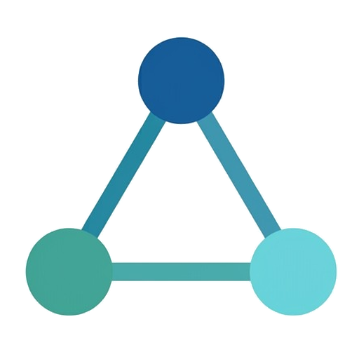
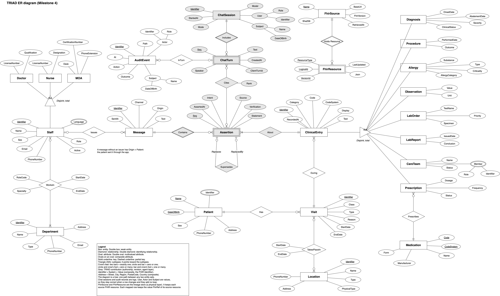

<h1>
  
  TRIAD
</h1>

**Trusted RDF Interoperable Agent Data**

CSC 501; Algorithms and Data Models (Fall 2026), Prof. Hossein Fani
University of Victoria

A data model for clinical records created and revised by multiple people over
time: typed entities for patients, encounters and clinical assertions, with
explicit relationships for authorship and revision, so the current state is
reached by traversal rather than by search. Clinical entities are modelled
against the HL7 FHIR standard.

## Quickstart

You need Python 3.12, [uv](https://docs.astral.sh/uv/), Node.js 20.19 or later and SQLite 3.43 or later.
Run the commands from the root folder of the repository. All data is synthetic.

```sh
# Install the Python packages and the frontend packages.
uv venv --python 3.12 .venv
uv pip install --python .venv/bin/python -r requirements.txt
npm --prefix src/frontend ci

# Start the API (port 8000) and the app (port 5173). The script builds the database if it is missing.
./src/scripts/dev.sh
```

Open http://127.0.0.1:5173 and select **Demo guide** in the top bar. The guide follows the
hospital-visit journey of [`USER_FLOWS.md`](USER_FLOWS.md), Use case 0 to Use case 9. Each step of a
use case has an **Act as** button that sets the user and opens the page. One Ctrl+C stops the two servers.
To start again with a new database, run `./src/scripts/dev.sh --reset-db`.

### Settings and the LLM mode (optional)

The first run of `dev.sh` makes two settings files from their `.env.example` files. Git ignores them.

- `src/backend/.env`: the backend settings and the API keys.
- `src/frontend/.env`: the frontend settings. Each `VITE_` value in it is public, so never put a key there.

The Care Assistant uses a fake language model by default. It needs no API key and no network.
To use a real model (Gemini has a free tier):

```sh
uv pip install --python .venv/bin/python -r requirements-llm.txt
# Get a key at https://aistudio.google.com/apikey. Then, in src/backend/.env, set:
#     TRIAD_LLM=llm
#     GEMINI_API_KEY=<your key>
./src/scripts/dev.sh                                        # start it again after each change to a .env file
```

If the key is missing, the server prints what is missing and uses the fake model.
See [`src/backend/README.md`](src/backend/README.md#settings-and-secrets-env) for all settings.

### Other commands

```sh
.venv/bin/python -m pytest -q                               # the 418 backend tests (about 10 s)
npm --prefix src/frontend run build                         # type-check and build the frontend into src/frontend/dist/
npm --prefix src/frontend run check:demo                    # check the users and the pages of the Demo guide
.venv/bin/python src/backend/main.py serve                  # serve the built app and the API on http://127.0.0.1:8000
.venv/bin/python src/backend/main.py ensure-db --reset-db   # build the database again from the FHIR data (about 3 s)
```

### SQL scripts (sqlite3 only)

```sh
cd src/backend/models/relational/sql
sqlite3 triad.db < ddl/01_create_tables.sql                   # the schema: 29 relations and 11 triggers
sqlite3 triad.db < dml/02_insert_seed.sql                     # the scenario data
sqlite3 -header -column triad.db < dml/03_select_queries.sql  # the queries Q1 to Q14
```

The scripts `04_update_delete.sql` and `05_constraint_violations.sql` change the data, so run them on a copy.
See [`src/backend/models/relational/sql/README.md`](src/backend/models/relational/sql/README.md).

More information: [`src/backend/README.md`](src/backend/README.md) (the layers, the environment
variables and the LLM mode), [`src/frontend/README.md`](src/frontend/README.md) and the API contract
[`doc/api.md`](doc/api.md).

## Design choice: user switching instead of a login

The prototype has no login. This is a design choice, so that the demo and the tests are fast.

- **User switching.** The top bar selects the user type and the user. The frontend sends the user key
  in the header `X-Triad-User` with each request. Each step of the Demo guide has an **Act as** button.
  So one person can test all the use cases of all the user groups in a few minutes.
- **Authorization is real.** The backend checks each request against the permission rules of
  [`USER_FLOWS.md`](USER_FLOWS.md#2-permissions) section 2: the care-team rule, the role matrix and the
  patient-visible rule. A denied request gets 403. When the request is about a patient, the backend also
  writes an audit record (outcome "Denied"). A request with no user or an unknown user gets 401.
- **Authentication is not real.** The backend trusts the header, so any client can act as any user.
  Authorization is decoupled from authentication: the access rules need only an `Actor`, and one
  function makes the `Actor` (`get_actor` in [`src/backend/api/actor.py`](src/backend/api/actor.py)).
- **A real system adds a login.** For example, the single sign-on of the hospital with OpenID Connect,
  or SMART on FHIR. The server then takes the user from the verified token, not from a header that the
  client sets. Only `get_actor` changes. The user switcher is then removed, or kept only in a test build.
- **Synthetic data only.** For this reason, the prototype must hold only synthetic data.

## Data model (Milestone 4)

TRIAD records each clinical fact as an **Assertion**. A staff member issues a
**Message**, and the message contains one or more assertions. Each assertion
is about one **ClinicalEntry**, and each entry belongs to one **Visit** of a
**Patient**. A unary **Supersedes** relationship records what replaced what.
The current fact is the assertion that nothing supersedes.

The diagram is a tree: there is exactly one path between any two entity sets.
Grey marks the TRIAD contribution (authorship, revision and the agent layer).



- Notes on the model (notation, design rules, changes from Milestone 2, FHIR R4
  alignment): [`src/backend/models/er/README.md`](src/backend/models/er/README.md)
- The diagram as PDF: [`src/backend/models/er/TRIAD_ERD.pdf`](src/backend/models/er/TRIAD_ERD.pdf)
- The user flows of the prototype: [`USER_FLOWS.md`](USER_FLOWS.md)
- The Milestone 2 draft stays in [`assets/designing_erd/`](assets/designing_erd/).

## Team

- Asish George
- Mohamed Khaled

## Repository layout

```
proposal/                     Milestone 1: project definition (LaTeX source + compiled PDF)
background_and_related_work/  Milestone 2: background, related work and draft ERD (LaTeX source + compiled PDF)
USER_FLOWS.md                 Milestone 4: the user flows of the prototype
src/backend/models/er/        Milestone 4: the ER diagram and its notes
src/backend/data/             Milestone 4: the source data (Synthea FHIR R4 sample and the TRIAD scenario data)
src/scripts/                  Milestone 4: scripts that get and build the data
doc/                          Milestone 4: project notes (for example, the AI review log)
assets/figures/               Figures used in the reports
assets/designing_erd/         Milestone 2: ERD draw.io sources and data-model documentation
assets/                       Logo and icon
```

## Milestones

| # | Deliverable | Due | Report |
|---|-------------|-----|--------|
| 1 | Project definition and team formation | Sep 23 | [PDF](proposal/TRIAD_Proposal.pdf) |
| 2 | Background and related work | Oct 7 | [PDF](background_and_related_work/02_Background.pdf) |
| 3 | 3MT proposal presentation | Oct 15 | |
| 4 | Solution design and implementation (relational) | Nov 4 | In progress |
| 5 | Evaluation | Nov 18 | |
| 6 | 10MT demo | Nov 26 | |
