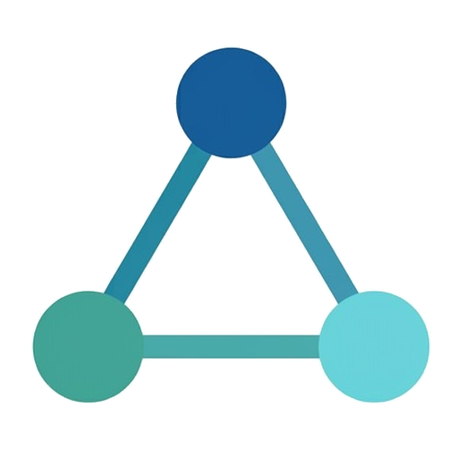
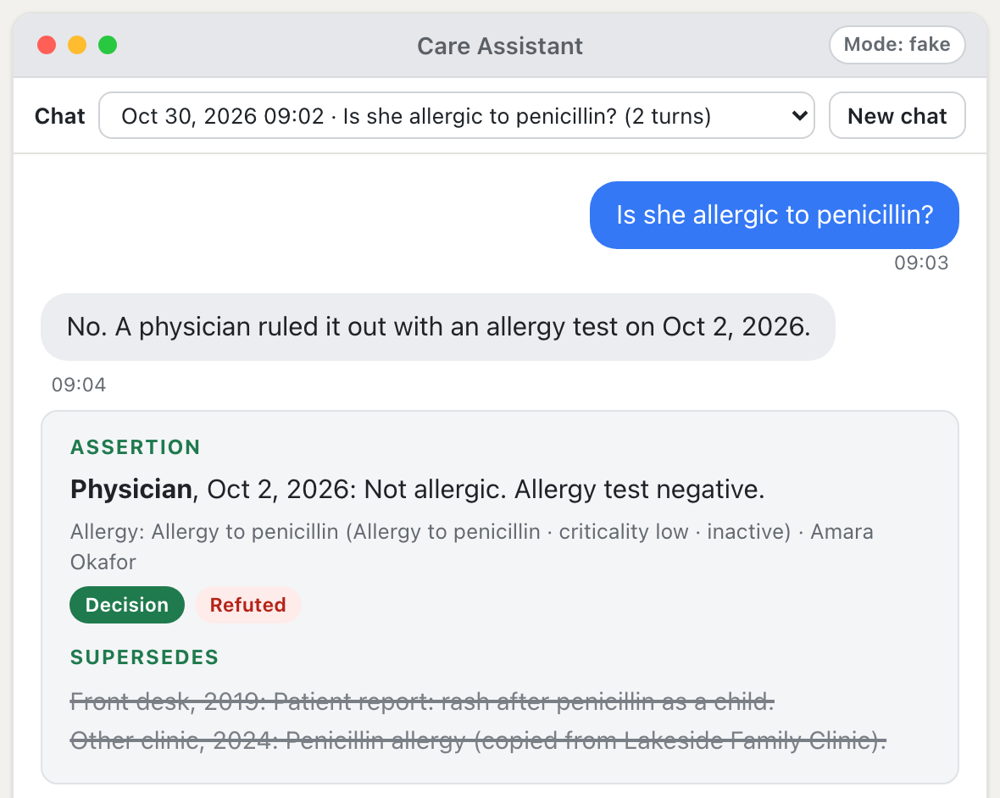
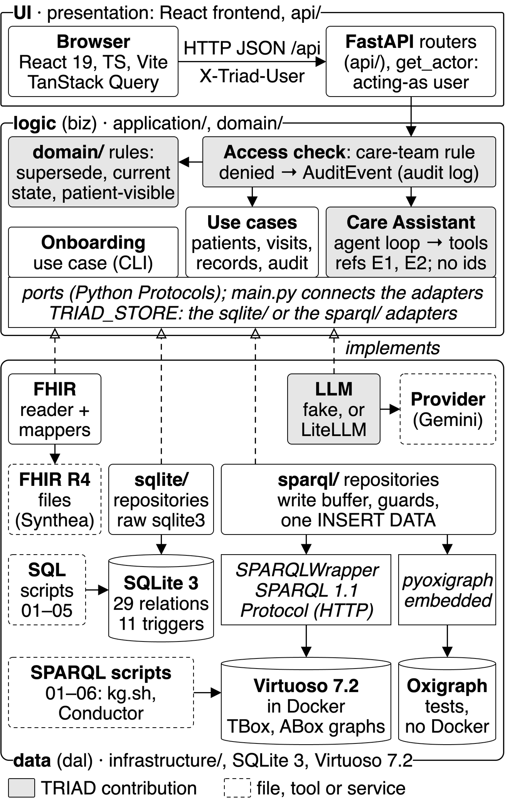
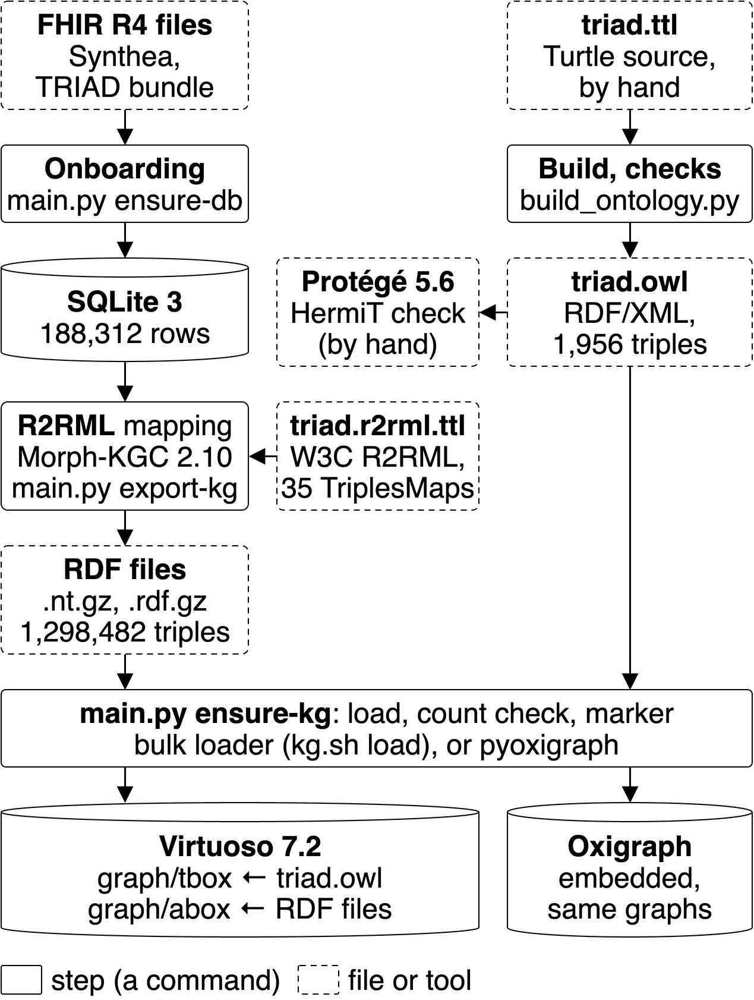
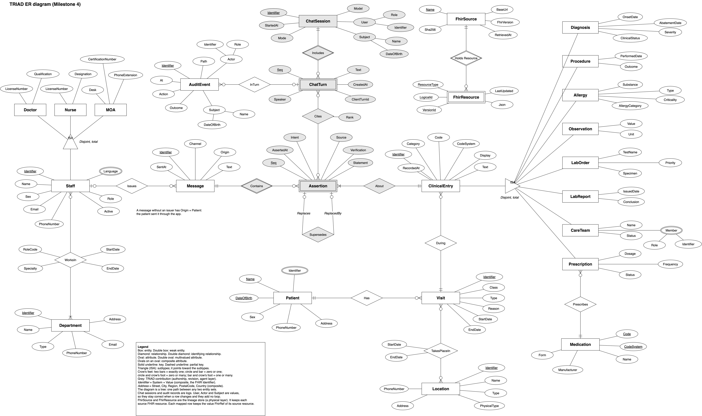
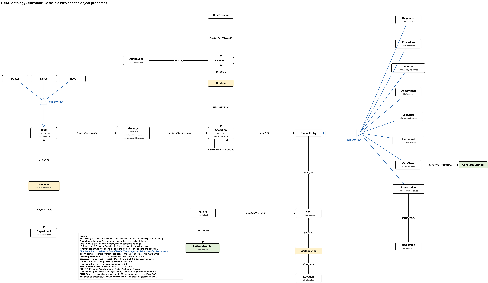

<h1>
  
  TRIAD
</h1>

**Trusted RDF Interoperable Agent Data**

CSC 501; Algorithms and Data Models (Fall 2026), Prof. Hossein Fani
University of Victoria

TRIAD is a data model for clinical records that many people make and change over time.
Each clinical fact is an assertion with an author and a source. When a fact changes, a new assertion
supersedes the old one, and the old one stays. So the current state of a record is the result of a
traversal (follow the Supersedes links to the head), not of a search. The clinical entities follow the
HL7 FHIR R4 standard. The Milestone 4 prototype is a hospital web app on a relational database (SQLite)
with a Care Assistant chat that answers from the current assertions and shows what they supersede.

Milestone 5 adds a knowledge graph. An OWL 2 ontology (`triad.owl`, RDF/XML) holds the ER model as classes,
properties, keys and cardinality restrictions. A W3C R2RML mapping changes the relational data into RDF
(1,298,482 triples). The triple store is Virtuoso 7.2: the ontology is in a TBox graph, and the data is in an
ABox graph. The SPARQL scripts `01` to `06` do the INSERT, SELECT, UPDATE and DELETE operations of the course
manual, and each SELECT query gives the same rows as its SQL query. The same web app runs on SQLite, on
Virtuoso or on the embedded store Oxigraph: SPARQL adapters implement the same ports as the SQLite adapters.

## Illustrative sample

The 3MT slide asks: "Is she allergic to penicillin?" The chart of Patient A has three assertions about
one allergy: a patient report at the front desk (2019), a copy from another clinic (2024), and an allergy
test by a physician (2026) that refutes the allergy. The Care Assistant answers from the current assertion
and shows the two old assertions with a line through them:



The query behind the answer follows the Supersedes chain. SQL needs a recursive query for this. SPARQL has no
recursion, but the property path `triad:supersedes*` follows the chain from the current assertion.
This is query Q2 in both forms, as it is in the script files.

SQL (Milestone 4, [`dml/03_select_queries.sql`](src/backend/models/relational/sql/dml/03_select_queries.sql)):

```sql
-- Q2. The revision chain of one fact: start at the current assertion and follow Supersedes back.
WITH RECURSIVE chain (Id, SupersedesId, Depth) AS (
    SELECT a.Id, a.SupersedesId, 0
    FROM Assertion a
    JOIN ClinicalEntry e ON e.Id = a.ClinicalEntryId
    JOIN Allergy al ON al.ClinicalEntryId = e.Id
    JOIN Visit v ON v.Id = e.VisitId
    JOIN Patient p ON p.Id = v.PatientId
    WHERE p.Name = 'Elena Marsh' AND p.DateOfBirth = '1971-05-14'
      AND lower(al.Substance) LIKE '%penicillin%'
      AND NOT EXISTS (SELECT 1 FROM Assertion n WHERE n.SupersedesId = a.Id)
    UNION ALL
    SELECT a.Id, a.SupersedesId, c.Depth + 1
    FROM Assertion a JOIN chain c ON a.Id = c.SupersedesId
)
SELECT c.Depth, substr(a.AssertedAt, 1, 10) AS Date, COALESCE(s.Name, 'Patient') AS Author, s.Role,
       m.Origin, a.Verification, a.Statement
FROM chain c
JOIN Assertion a ON a.Id = c.Id
JOIN Message m ON m.Id = a.MessageId
LEFT JOIN Staff s ON s.Id = m.StaffId
ORDER BY c.Depth;
```

SPARQL (Milestone 5, [`sparql/03_select_queries.sparql`](src/backend/models/semantic/sparql/03_select_queries.sparql)):

```sparql
PREFIX xsd:   <http://www.w3.org/2001/XMLSchema#>
PREFIX triad: <https://github.com/MohamedKhalidmk/TRIAD/ontology/triad#>

# Q2. The revision chain of the penicillin fact of Patient A: start at the current assertion and go back.
#     SQL: Q2 (a recursive WITH). SPARQL has no recursion; the path triad:supersedes* replaces it.
#     ?depth = the number of steps from the current assertion (?head, depth 0) back to ?a.
#     For each ?a, ?mid takes each assertion from ?head to ?a (both included), so COUNT(?mid) - 1 is the depth.
#     ?role is the subtype of the issuer (Doctor, Nurse, MOA). It is unbound for a message with no issuer.
SELECT ((COUNT(?mid) - 1) AS ?depth) ?date ?author ?role ?origin ?verification ?statement
FROM <https://github.com/MohamedKhalidmk/TRIAD/graph/abox>
WHERE {
  ?p a triad:Patient ; triad:name "Elena Marsh" ; triad:dateOfBirth "1971-05-14"^^xsd:date ; triad:hasVisit ?v .
  ?e triad:during ?v ; a triad:Allergy ; triad:substance ?substance .
  FILTER (CONTAINS(LCASE(?substance), "penicillin"))
  ?head triad:about ?e .
  FILTER NOT EXISTS { ?n triad:supersedes ?head }
  ?head triad:supersedes* ?mid .
  ?mid triad:supersedes* ?a .
  ?a triad:assertedAt ?at ; triad:verification ?verification ; triad:statement ?statement .
  ?m triad:contains ?a ; triad:origin ?origin .
  OPTIONAL { ?s triad:issues ?m ; triad:name ?staffName ; a ?roleType .
             FILTER (?roleType IN (triad:Doctor, triad:Nurse, triad:MOA)) }
  BIND (COALESCE(?staffName, "Patient") AS ?author)
  BIND (STRAFTER(STR(?roleType), "#") AS ?role)
  BIND (SUBSTR(STR(?at), 1, 10) AS ?date)
}
GROUP BY ?a ?date ?author ?role ?origin ?verification ?statement
ORDER BY ?depth
```

Both queries give the same three rows (on the full data, SQLite and Oxigraph):

| depth | date | author | role | origin | verification | statement |
|---|---|---|---|---|---|---|
| 0 | 2026-10-02 | Amara Okafor | Doctor | Staff | Refuted | Not allergic. Allergy test negative. |
| 1 | 2024-03-05 | Sofia Alvarez | MOA | OtherClinic | Unconfirmed | Penicillin allergy (copied from Lakeside Family Clinic). |
| 2 | 2019-06-12 | Sofia Alvarez | MOA | Patient | Unconfirmed | Patient report: rash after penicillin as a child. |

## Prerequisites

- macOS or Linux. On Windows, use WSL2.
- [uv](https://docs.astral.sh/uv/) (it gets Python 3.12 itself), or Python 3.12 if uv is not installed.
- Node.js 20.19 or later (in version 22: 22.12 or later) with npm.
- **For Virtuoso (optional):** [Docker](https://docs.docker.com/get-docker/) (Docker Desktop on macOS). `kg.sh`
  pulls the Virtuoso Open Source 7.2 image the first time. Without Docker, the app uses the embedded store
  Oxigraph, or you can install Virtuoso yourself (see [Triple store setup](#triple-store-setup)).
- **Optional:** the `sqlite3` command (SQLite 3.43 or later) for the plain SQL scripts;
  [Protégé](https://protege.stanford.edu/) 5.6 (desktop) to open the ontology; a web browser for Conductor.

All data is synthetic. The Python packages have fixed versions:

| File | Packages |
|---|---|
| [`requirements.txt`](requirements.txt) | FastAPI, uvicorn, httpx2, python-dotenv, pytest; it includes `requirements-kg.txt` |
| [`requirements-kg.txt`](requirements-kg.txt) | morph-kgc[sqlite] 2.10.0, pyoxigraph 0.3.22, rdflib 7.2.1, pyshacl 0.31.0, owlrl 7.1.4, SPARQLWrapper 2.0.0 (keep these versions together: Morph-KGC needs pyoxigraph < 0.4 and rdflib < 7.3) |
| [`requirements-llm.txt`](requirements-llm.txt) | litellm (only for the optional LLM mode) |
| [`requirements-dbview.txt`](requirements-dbview.txt) | datasette (only for the optional database viewer) |

## Installation

`quickstart.sh` (below) does all the installation steps. To install by hand, run these commands from the root
folder of the repository:

```sh
git clone https://github.com/MohamedKhalidmk/TRIAD.git
cd TRIAD
uv venv --python 3.12 .venv
uv pip install --python .venv/bin/python -r requirements.txt   # also installs requirements-kg.txt
npm --prefix src/frontend ci
npm --prefix src/frontend run build                            # build the frontend into src/frontend/dist/
.venv/bin/python src/backend/main.py ensure-db                 # build the SQLite database from the FHIR data (3 to 7 s)
.venv/bin/python -m pytest -q -m "not slow and not virtuoso"   # the fast tests
```

Then select a store, build its knowledge graph and serve the app (see [Triple store setup](#triple-store-setup)):

```sh
./src/scripts/kg.sh up && ./src/scripts/kg.sh init                  # start Virtuoso in Docker
.venv/bin/python src/backend/main.py ensure-kg --store virtuoso     # build the graph (or: --store oxigraph, no Docker)
.venv/bin/python src/backend/main.py serve --store virtuoso         # the app on http://127.0.0.1:8000
```

## Quickstart

From the root folder of the repository:

```sh
./src/scripts/quickstart.sh
```

The script checks the prerequisites, makes the Python environment, installs the pinned packages, builds the
frontend, builds the database from the FHIR data, builds the knowledge graph, runs the fast tests, and then
serves the app on http://127.0.0.1:8000.

**The data store.** With no option, the store is the knowledge graph: Virtuoso 7.2 when Docker runs, else
Oxigraph (the script tells why). `--store` selects the store:

| Command | Store | Steps |
|---|---|---|
| `./src/scripts/quickstart.sh --store virtuoso` | the knowledge graph in Virtuoso 7.2 (Docker): `kg.sh up`, `kg.sh init`, then `main.py ensure-kg` | 9 |
| `./src/scripts/quickstart.sh --store oxigraph` | the knowledge graph in Oxigraph, inside the Python process (no Docker) | 8 |
| `./src/scripts/quickstart.sh --store sqlite` | the relational database of Milestone 4 (the same app, with no knowledge graph) | 7 |

The other options:

- `--reset-db`: build the SQLite database again first.
- `--reset-kg`: build the knowledge graph again. **This deletes the writes that the app made in KG mode.**
- `--check`: do all the steps, start the server, check `GET /api/health` (also the store), and stop the server.
- `--help`: show the help.

**The time.** Measured on one laptop (macOS on arm64) with Oxigraph: the first run takes 2 min 27 s (the
graph build is 31 s of it), and a second run takes 1 min 37 s (most of it is the fast tests). With Virtuoso,
the first run takes 1 min 59 s when the image is on the computer (the graph build and load is 22 s of it; the
image pull of 51 MB comes on top the first time), and a second run takes 1 min 20 s. On a second laptop (macOS
on arm64, 8 GB of memory, Python 3.12 without uv; a new clone, 2026-11-17), with Virtuoso: the first run takes about
4 min 30 s to the server (the graph build and load is 61 s of it), and a second run takes 2 min 31 s; with Oxigraph
(Docker stopped) a run takes 2 min 35 s (the graph build is 27 s of it); with `--store sqlite`, 2 min 6 s. A second run builds nothing again: the
build marker of the store is current. A rebuild of the graph (a changed database, or `--reset-kg`) deletes
the writes of KG mode. To use another port: `PORT=9000 ./src/scripts/quickstart.sh`.

Open http://127.0.0.1:8000 and select **Demo guide** in the top bar. The guide follows the
hospital-visit journey of [`USER_FLOWS.md`](USER_FLOWS.md), Use case 0 to Use case 9. Each step of a
use case has an **Act as** button that sets the user and opens the page. The badge in the top bar shows the
store. Ctrl+C stops the server. **Virtuoso keeps running:** stop it with `./src/scripts/kg.sh down`
(the data stays in its Docker volume).

### Development mode

```sh
./src/scripts/dev.sh                     # the API with hot reload on port 8000 and the app (Vite) on port 5173
./src/scripts/dev.sh --reset-db          # the same, but build the database again first
./src/scripts/dev.sh --store oxigraph    # the store: sqlite, oxigraph or virtuoso
./src/scripts/dev.sh --store virtuoso --reset-kg   # build the knowledge graph again (this deletes the KG-mode writes)
PORT=9000 VITE_PORT=5174 ./src/scripts/dev.sh      # other ports
```

`dev.sh` takes the store from `--store`, else from `TRIAD_STORE` (the shell or `src/backend/.env`), else
`sqlite`. For a knowledge-graph store, it runs `main.py ensure-kg` first. For `virtuoso`, it also runs
`kg.sh up` and `kg.sh init` if Virtuoso does not answer.
Open http://127.0.0.1:5173. One Ctrl+C stops the two servers.

### Settings and the LLM mode (optional)

The first run of a script makes two settings files from their `.env.example` files. Git ignores them.

- `src/backend/.env`: the backend settings and the API keys.
- `src/frontend/.env`: the frontend settings. Each `VITE_` value in it is public, so never put a key there.

The Care Assistant uses a fake language model by default. It needs no API key and no network.
To use a real model (Gemini has a free tier):

```sh
uv pip install --python .venv/bin/python -r requirements-llm.txt
# Get a key at https://aistudio.google.com/apikey. Then, in src/backend/.env, set:
#     TRIAD_LLM=llm
#     GEMINI_API_KEY=<your key>
./src/scripts/dev.sh                                        # start it again after each change to a .env file
```

If the key is missing, the server prints what is missing and uses the fake model.
By default, the backend logs each SQL statement (`TRIAD_SQL_LOG`) or each SPARQL request (`TRIAD_SPARQL_LOG`)
of a request with its time, and it uses the clock of the computer (`TRIAD_NOW`).
See [`src/backend/README.md`](src/backend/README.md#settings-and-secrets-env) for all settings.

## Architecture



Each request goes through the access check before a use case. Each adapter of the data layer implements a port
of the logic layer (dashed arrows). The data layer has two sets of repositories for the same ports:
`sqlite/` and `sparql/`. `TRIAD_STORE` selects one set, and only `main.py` knows them. Each box of the data
layer names its driver. Grey marks the TRIAD contribution. The figure is also in
[`doc/architecture.pdf`](doc/architecture.pdf); `src/scripts/build_architecture.py` makes it.

The backend follows Clean Architecture. The table gives the names of the course manual, the folders and the driver
of each layer.

| Layer (manual) | Clean Architecture | Folders | Driver |
|---|---|---|---|
| UI | presentation | [`src/frontend/`](src/frontend/) (React, Vite, TypeScript) and [`src/backend/api/`](src/backend/api/) (FastAPI routers) | `fetch` with TanStack Query in the browser (HTTP JSON); FastAPI and uvicorn on the server |
| logic (biz) | use cases and domain | [`src/backend/application/`](src/backend/application/) (use cases, ports) and [`src/backend/domain/`](src/backend/domain/) (entities and rules) | none: plain Python; the ports are Python `Protocol` classes |
| data (dal), relational | adapters and the database | [`src/backend/infrastructure/sqlite/`](src/backend/infrastructure/sqlite/) and [`src/backend/models/relational/`](src/backend/models/relational/) (relations, SQL) | `sqlite3` of the Python standard library (raw SQL) → SQLite 3 |
| data (dal), semantic web | adapters and the triple store | [`src/backend/infrastructure/sparql/`](src/backend/infrastructure/sparql/) (repositories, guards), [`src/backend/infrastructure/rdf/`](src/backend/infrastructure/rdf/) (export, load, SHACL) and [`src/backend/models/semantic/`](src/backend/models/semantic/) (ontology, mapping, SPARQL) | **SPARQLWrapper** 2.0.0 (the SPARQL 1.1 Protocol over HTTP) → Virtuoso 7.2; **pyoxigraph** 0.3.22 (embedded) → Oxigraph; Morph-KGC 2.10.0 for the R2RML export |
| data (dal), other | adapters | [`src/backend/infrastructure/fhir/`](src/backend/infrastructure/fhir/) (FHIR reader) and [`src/backend/infrastructure/llm/`](src/backend/infrastructure/llm/) (language models) | the Python standard library; LiteLLM (optional) |

- **The dependency rule.** `api` → `application` → `domain`. `infrastructure` → the ports of `application`
  and `domain`. Only [`src/backend/main.py`](src/backend/main.py) (the composition root) knows the adapters.
  Only `infrastructure/`, `models/semantic/` and the tests import the RDF packages (a test checks this).
- **The relational store.** SQLite 3 through the Python `sqlite3` module, with raw SQL and no ORM.
  Each list endpoint gives pages (`LIMIT ? OFFSET ?`). The API contract is [`doc/api.md`](doc/api.md).
- **The knowledge-graph store.** The SPARQL repositories send standard SPARQL 1.1 only. Virtuoso gets the
  queries on `/sparql` (no login) and the updates on `/sparql-auth` (digest login as the user `triad`).
  Each write goes into a write buffer. At the end of the write, Python guards check the rules of the SQL
  triggers, and one `INSERT DATA` sends the new triples. See [Store switch](#store-switch).
- **The Care Assistant.** The same tools serve the fake model and the real model, on each store. Each tool is
  bound to the user and the patient of the request and runs one query. The model gets references (`E1`, `E2`),
  never a database id, a patient name or a date of birth.

The second figure shows how the knowledge graph is built (also in [`doc/kg_build.pdf`](doc/kg_build.pdf)):



More information: [`src/backend/README.md`](src/backend/README.md) and [`src/frontend/README.md`](src/frontend/README.md).

## Data model

TRIAD records each clinical fact as an **Assertion**. A staff member issues a
**Message**, and the message contains one or more assertions. Each assertion
is about one **ClinicalEntry**, and each entry belongs to one **Visit** of a
**Patient**. A unary **Supersedes** relationship records what replaced what.
The current fact is the assertion that nothing supersedes.

The diagram is a tree: there is exactly one path between any two entity sets.
Grey marks the TRIAD contribution (authorship, revision and the agent layer).



- Notes on the model (notation, design rules, changes from Milestone 2, FHIR R4
  alignment): [`src/backend/models/er/README.md`](src/backend/models/er/README.md)
- The diagram as PDF: [`src/backend/models/er/TRIAD_ERD.pdf`](src/backend/models/er/TRIAD_ERD.pdf)
- The relational schema (29 relations, 11 triggers): [`src/backend/models/relational/`](src/backend/models/relational/)
- The ontology (the same model in OWL 2): [`src/backend/models/semantic/ontology.md`](src/backend/models/semantic/ontology.md)
  and [Knowledge graph (Milestone 5)](#knowledge-graph-milestone-5)
- The user flows of the prototype: [`USER_FLOWS.md`](USER_FLOWS.md)
- The Milestone 2 draft stays in [`assets/designing_erd/`](assets/designing_erd/).

## Knowledge graph (Milestone 5)

### The ontology



The figure shows the 28 classes at the positions of the ER diagram. A black arrow is a stored object
property, from its domain to its range. A blue line with a hollow head is `rdfs:subClassOf`.
[`ontology.md`](src/backend/models/semantic/ontology.md) gives the full ER → OWL mapping: each class, property,
restriction and key, and the coverage of each column of the DDL. The figure is also in
[`TRIAD_ontology.pdf`](src/backend/models/semantic/TRIAD_ontology.pdf).

- **The ontology** (`triad:` terms only): 28 classes, 25 object properties (17 stored, 5 named inverses,
  3 derived by property chains), 92 datatype properties, 17 closed value sets, 18 `owl:hasKey` axioms,
  100 cardinality restrictions (`owl:minCardinality`, `owl:maxCardinality`, `owl:cardinality` and their
  qualified forms), 3 disjointness axioms. `triad.owl` has 1,956 triples.
- **Source and output.** [`triad.ttl`](src/backend/models/semantic/triad.ttl) is the hand-written Turtle source.
  `build_ontology.py` checks it (OWL 2 DL rules, the coverage of the DDL, the tree) and writes
  [`triad.owl`](src/backend/models/semantic/triad.owl) (RDF/XML), the same bytes on each run.
- **What OWL cannot hold.** OWL uses the Open World Assumption: a missing triple is unknown, not an error.
  So the closed-world rules of the SQL schema go to the SHACL shapes
  ([`shapes/`](src/backend/models/semantic/shapes/): 29 node shapes, 28 SPARQL constraints), to the 24 checks of
  `05_constraint_checks.sparql`, and to the guards of the app ([`ontology.md`](src/backend/models/semantic/ontology.md)
  section 8).

### IRIs, graphs and the endpoint

| Item | IRI or URL |
|---|---|
| The ontology IRI | `https://github.com/MohamedKhalidmk/TRIAD/ontology/triad` (version IRI `…/ontology/triad/5.0.0`) |
| The terms (prefix `triad:`) | `https://github.com/MohamedKhalidmk/TRIAD/ontology/triad#` (for example `triad:Assertion`, `triad:supersedes`) |
| The individuals | `https://github.com/MohamedKhalidmk/TRIAD/kg/<class path>/<Id>` (for example `…/kg/assertion/3`); no IRI holds a name or a date of birth |
| The TBox graph (the ontology) | `https://github.com/MohamedKhalidmk/TRIAD/graph/tbox` |
| The ABox graph (the data) | `https://github.com/MohamedKhalidmk/TRIAD/graph/abox` |
| The scratch graph | `https://github.com/MohamedKhalidmk/TRIAD/graph/scratch` (the planted checks and the test copies) |
| The meta graph | `https://github.com/MohamedKhalidmk/TRIAD/graph/meta` (the id counters and the build marker of the app) |
| The SPARQL endpoint (no login) | http://localhost:8890/sparql |
| The update endpoint of the app (digest login) | http://localhost:8890/sparql-auth |
| Conductor (the admin pages of Virtuoso) | http://localhost:8890/conductor |

`kg.sh` publishes Virtuoso on 127.0.0.1 only. `KG_HTTP_PORT` changes the port 8890.

### The knowledge graph

The W3C R2RML mapping [`mapping/triad.r2rml.ttl`](src/backend/models/semantic/mapping/triad.r2rml.ttl)
(35 TriplesMaps) changes the SQLite data into RDF. Morph-KGC runs it (`main.py export-kg`, about 10 s).
The export compares the triples of each predicate and of each class with the SQL counts, and it stops if one
count differs.

| Graph | Triples | Notes |
|---|---|---|
| The full graph of a new clone (`main.py export-kg`) | 1,298,482 | 188,271 `rdf:type`, 911,697 attribute and 198,514 foreign-key triples; 130,959 individuals from 188,312 rows. Git ignores the files (`src/backend/data/kg/`). |
| The seed graph [`kg/triad_kg_seed.rdf`](src/backend/models/semantic/kg/triad_kg_seed.rdf) | 1,125 | RDF/XML, committed: the scenario data (Patient A, 25 staff members, the departments and the locations), for the upload by hand. |
| The TBox graph (`triad.owl`) | 1,956 | RDF/XML, committed. |

### The files of Appendix A of the course manual

| Appendix A | TRIAD |
|---|---|
| `dal/models/semantic/` | [`src/backend/models/semantic/`](src/backend/models/semantic/) (see its [README](src/backend/models/semantic/README.md)) |
| the ontology `*.owl` | [`src/backend/models/semantic/triad.owl`](src/backend/models/semantic/triad.owl) (RDF/XML; the source is `triad.ttl`) |
| the knowledge-graph triples `*.rdf` | [`src/backend/models/semantic/kg/triad_kg_seed.rdf`](src/backend/models/semantic/kg/triad_kg_seed.rdf) (RDF/XML, committed); the full graph `src/backend/data/kg/triad_kg.rdf.gz` (RDF/XML) and `triad_kg.nt.gz` (N-Triples), made by `main.py export-kg` |
| the DML queries `*.sparql` | [`src/backend/models/semantic/sparql/01_create_graphs.sparql`](src/backend/models/semantic/sparql/) to `06_debug.sparql` |
| `requirements.txt` | [`requirements.txt`](requirements.txt) (it includes [`requirements-kg.txt`](requirements-kg.txt)) |

## Triple store setup

The triple store is **Virtuoso Open Source 7.2** (the store of the course manual). The image is
`openlink/virtuoso-opensource-7:7.2.17-r25.1-g2850f18-ubuntu`, pinned by its digest in
[`src/scripts/kg.sh`](src/scripts/kg.sh). The tests and a computer with no Docker use **Oxigraph**
(pyoxigraph 0.3.22) inside the Python process.

### With Docker: kg.sh

```sh
./src/scripts/kg.sh up        # start Virtuoso (the first run makes the container triad-virtuoso and its volume)
./src/scripts/kg.sh init      # make the user triad, and set the roles and the graph permissions (manual 5.2.3)
./src/scripts/kg.sh load      # triad.owl -> TBox graph; ensure-db, export-kg, then the full graph -> ABox graph
./src/scripts/kg.sh status    # the container, the triples of each graph and the access rules
./src/scripts/kg.sh open      # the URLs of Conductor and of the SPARQL endpoint
./src/scripts/kg.sh down      # stop the container (the data stays in the volume)
./src/scripts/kg.sh reset     # remove the container and its volume (this deletes all the data of Virtuoso)
./src/scripts/kg.sh help      # all commands and settings
```

- Measured: `up` takes 5 to 7 s, `init` less than 1 s, the export about 10 s, and the bulk load with the
  checkpoint about 4 s.
- `kg.sh load --seed` loads the seed graph in place of the full graph. `kg.sh load` checks the load list of the
  bulk loader and compares the triples of each predicate with the export (`isql` gives the exit code 0 also on
  an error, so the script checks the result itself).
- `kg.sh load` writes no build marker. The app uses `main.py ensure-kg --store virtuoso`: it exports the data,
  runs `kg.sh load --no-export`, seeds the id counters and writes the marker. `quickstart.sh` does this.
- **The image uses its settings only at the first start of an empty volume** (the password of `dba`, the
  buffers, `MaxSortedTopRows`). After a change of `TRIAD_VIRTUOSO_DBA_PASSWORD`, run `kg.sh reset` (this deletes
  all the data of Virtuoso), then `kg.sh up`. After a change of `KG_HTTP_PORT`, run `docker rm -f triad-virtuoso`
  and `kg.sh up` (the data stays). After a change of `TRIAD_SPARQL_PASSWORD`, run `kg.sh init`.

### Without Docker

- **Oxigraph (automatic).** `quickstart.sh` uses `--store oxigraph` when Docker does not run. The graph is in
  `src/backend/data/kg/oxigraph/`. Oxigraph has no web page, and `kg.sh` does not apply to it.
- **A native Virtuoso.** Install Virtuoso Open Source 7.2 (the macOS app of the course manual, or the package
  of your system). Add the folders `src/backend/data/kg` and `src/backend/models/semantic` (absolute paths) to
  `DirsAllowed` in `virtuoso.ini`, and start Virtuoso on the ports 1111 (isql) and 8890 (HTTP). Then set
  `KG_ISQL` to the isql command of that installation (for example `isql-vt` on Debian and Ubuntu):

  ```sh
  KG_ISQL=isql-vt ./src/scripts/kg.sh init
  KG_ISQL=isql-vt ./src/scripts/kg.sh load
  KG_ISQL=isql-vt ./src/scripts/quickstart.sh --store virtuoso   # with KG_ISQL, the script does not run "kg.sh up"
  ```

  With `KG_ISQL`, the commands `up`, `down` and `reset` are not available. The password of `dba` must be the one of
  `TRIAD_VIRTUOSO_DBA_PASSWORD` (the default of both is `dba`).

### Load the graphs by hand (the manual path)

This is the path of the course manual (5.2.1 to 5.2.3), in Conductor:

1. Start Virtuoso (`./src/scripts/kg.sh up`) and open http://localhost:8890/conductor. Log in as `dba` with the
   password `dba` (the default of `TRIAD_VIRTUOSO_DBA_PASSWORD`).
2. **The account step (5.2.3).** System Admin → User Accounts → the account `SPARQL`: select "User enabled"
   and give it the roles `SPARQL_SELECT` and `SPARQL_UPDATE`. Then run `./src/scripts/kg.sh init` one time.
   It does the same with SQL, makes the user `triad`, and sets the graph permissions of the table below.
3. **Linked Data → Quad Store Upload:**
   - the file `src/backend/models/semantic/triad.owl`, named graph IRI `https://github.com/MohamedKhalidmk/TRIAD/graph/tbox`;
   - the file `src/backend/models/semantic/kg/triad_kg_seed.rdf`, named graph IRI `https://github.com/MohamedKhalidmk/TRIAD/graph/abox`.

   The full graph is too large for the upload form. Load it with `./src/scripts/kg.sh load`.
4. **Linked Data → Graphs:** check the two graphs. Then run B.1 and B.1a of `06_debug.sparql` on the SPARQL page
   (http://localhost:8890/sparql).
5. Run `02` to `06` on the SPARQL page (see [SPARQL scripts](#sparql-scripts)).

The Conductor SPARQL page runs as the anonymous account `SPARQL`. This account cannot LOAD, and it cannot write the
TBox graph. So `01_create_graphs.sparql` (it loads `triad.owl` into the TBox graph) runs with
`./src/scripts/kg.sh sparql 01_create_graphs.sparql`, not on that page. On the manual path, the Quad Store Upload
of step 3 does the same.

### The access rules

After `kg.sh init` (the manual setup):

| User | Endpoint | What it can do |
|---|---|---|
| the account `SPARQL` (anonymous) | `/sparql` and the Conductor SPARQL page | read all graphs; INSERT and DELETE only in the ABox and the scratch graphs; no LOAD |
| the user `triad` (the app and `kg.sh sparql`) | `/sparql-auth`, digest login | read; write the four TRIAD graphs; LOAD into the TBox and the scratch graphs |
| `dba` | Conductor, `isql` | all |

What we measured on Virtuoso 7.2.17:

| Request | Result |
|---|---|
| An anonymous INSERT on `/sparql` when the account `SPARQL` has no update role | HTTP 500 (SR186) |
| `triad` writes to an allowed graph | HTTP 200 |
| `triad` writes to another graph | HTTP 500 (SR619) |
| A wrong password | HTTP 401 |
| Basic authentication (not digest) | HTTP 401 |
| `CLEAR ALL` or `DROP ALL` as `triad` | HTTP 200, and nothing changes |

**Why `kg.sh init --strict` exists.** With the setup of the manual, each program that can open `/sparql` can
change the data of the ABox graph with no login. A real system does not allow this: only a known user writes. `--strict` removes
`SPARQL_UPDATE` from the account `SPARQL` and the write permissions of the users with no login. The app writes as
the user `triad` through `/sparql-auth`, so it works the same in the strict mode. Then `02` and `04` on the
Conductor SPARQL page give HTTP 500 (SR186). `kg.sh status` shows the mode.

## SPARQL scripts

The scripts are in [`src/backend/models/semantic/sparql/`](src/backend/models/semantic/sparql/). They are the
SPARQL forms of the SQL scripts, and they use standard SPARQL 1.1 only. Each operation starts with a marker line
(`# Q1. Title`, `# U1. …`).

| File | Forms | What it does |
|---|---|---|
| `01_create_graphs.sparql` | `CREATE SILENT GRAPH`, `CLEAR GRAPH`, `LOAD`, `SELECT` | Makes the four graphs, loads `triad.owl` from the `main` branch on GitHub into the TBox graph, counts the triples (G1–G4). Before the Milestone 5 merge, the LOAD gives HTTP 404: then use `kg.sh load`. |
| `02_insert_data.sparql` | `INSERT DATA` | A new patient (I1), and a new fact of Patient A with its visit, message, entry and assertion (I2). |
| `03_select_queries.sparql` | `SELECT`, `ASK`, `CONSTRUCT`, `DESCRIBE` | Q1–Q14b (the numbers of the SQL queries); QA (ASK), QC (CONSTRUCT: the PROV-O view of the slide chain), QD (DESCRIBE). |
| `04_update_delete.sparql` | `DELETE/INSERT … WHERE`, `DELETE … WHERE`, `DELETE DATA`, `DELETE WHERE`, `INSERT … WHERE`, `CLEAR` | U1–U8: two **UPDATE**s (SPARQL 1.1 has no UPDATE keyword: `DELETE/INSERT … WHERE`), a delete with a foreign-key rule, the delete of the person of `02`, and more. |
| `05_constraint_checks.sparql` | `SELECT` | C1–C24: one check for each rule of the SQL schema that OWL does not enforce. Each check gives no row on valid data. |
| `06_debug.sparql` | `SELECT` | Appendix B of the manual: B.1 all graphs, B.2 all triples of one graph, B.3 the classes of one graph, B.4 the classes of all graphs; B.1a and B.5 the counts. |

**Three ways to run a file:**

1. `kg.sh sparql` (all files; queries go to `/sparql`, updates to `/sparql-auth` as `triad`):

   ```sh
   ./src/scripts/kg.sh sparql 03_select_queries.sparql               # all operations
   ./src/scripts/kg.sh sparql 03_select_queries.sparql --only Q2,QA  # some operations
   ./src/scripts/kg.sh sparql 06_debug.sparql --only B.1,B.4
   ./src/scripts/kg.sh sparql 05_constraint_checks.sparql --max-rows 0
   ```

2. The Conductor SPARQL page (http://localhost:8890/sparql, files `02` to `06`): copy the PREFIX lines of the file
   and one operation into the query box, and select "Run Query".
3. `isql` as `dba` (all files): write `SPARQL` before each operation and `;` after it
   (`docker exec -it triad-virtuoso isql 1111 dba dba`).

**SQL = SPARQL.** All 16 queries Q1–Q14b give the same rows as their SQL queries on SQLite, on Oxigraph and on
Virtuoso (the full graph). QA, QC and QD give the result that SQL gives. `04` gives the same data as
`04_update_delete.sql`. The 24 checks of `05` give no row on valid data, and each one finds its planted error.
`tests/integration/test_kg_queries.py` checks this. The expected results, the measured times of each query on the
three stores and the writing rules for Virtuoso are in
[`sparql/README.md`](src/backend/models/semantic/sparql/README.md).

## Store switch

`TRIAD_STORE` (or `--store` of `quickstart.sh`, `dev.sh` and `main.py serve`) selects the store of the API:
`sqlite`, `virtuoso` or `oxigraph`. The default of the code is `sqlite`; the default of `quickstart.sh` is the
knowledge graph. The API, the use cases, the domain and the React app are the same on each store.
`GET /api/health` gives `store` and `ontologyVersion`, and the top bar shows the store.

What is different on a knowledge-graph store:

- **The text form of a time.** Both triple stores write `+00:00` as `Z` and remove the trailing zeros of the
  seconds. The app writes `Z` back as `+00:00`, but `09:00:00.100-04:00` comes back as `09:00:00.1-04:00`.
  The instant and the offset do not change.
- **Text search.** The search uses `CONTAINS(LCASE(…))`. `%` and `_` are normal characters, not wildcards as in
  SQLite `LIKE`, and `LCASE` makes all letters lower case (SQLite `lower()` changes only ASCII letters).
- **The order of times on Virtuoso.** Virtuoso orders and compares `xsd:dateTime` values by the text, not by the
  instant (SQLite and Oxigraph use the instant). The order is different only for two times with different
  offsets that are less than 7 hours apart.
- **One writer process for each store.** The write lock is in the process. Do not start two TRIAD servers on one
  Virtuoso: a second process can make the same IRI (the check before the commit then gives a conflict).
- **No transaction of more than one operation.** Virtuoso does not run one request as one transaction. So each
  write goes into a write buffer, Python guards check the rules of the SQL triggers, and one `INSERT DATA` sends
  the new triples. If a later operation fails, the app sends the inverse of the operations before it.
- **A rebuild deletes the writes of KG mode.** The store keeps a build marker: a hash of the SQLite data, a hash
  of the mapping and the ontology version. If one of them changes (or with `--reset-kg`), `ensure-kg` builds the
  graph again from SQLite, and the writes that the app made in the graph are lost.
- **The logs.** `TRIAD_SPARQL_LOG` (not `TRIAD_SQL_LOG`) logs each SPARQL request with its time.
  `dbview.sh` shows only the SQLite database.

[`src/backend/README.md`](src/backend/README.md#the-knowledge-graph-store) explains the adapters, the guards and
the tests of each store.

## Sample data

The sample data has 113 patients, 5,090 visits, 57,020 clinical entries and 57,022 assertions.
We onboarded it from the Synthea FHIR R4 sample (US Core, commit `84f5980`) and one curated FHIR R4 bundle,
through our FHIR onboarding pipeline. Every row keeps the FHIR identifier of its source resource,
so the data stays FHIR compliant. The knowledge graph holds the same data (188,312 rows give 1,298,482 triples).

- The sources, their checksums and how to get them again: [`src/backend/data/raw/README.md`](src/backend/data/raw/README.md)
- The mapping from FHIR R4 to the relations: [`doc/fhir_mapping.md`](doc/fhir_mapping.md)
- `python src/backend/main.py ensure-db --reset-db` builds the database from the FHIR files again (3 to 7 s).

## DBMS and SQL scripts

The DBMS is SQLite 3.43 or later. The scripts run with the `sqlite3` command and need no Python:

```sh
cd src/backend/models/relational/sql
sqlite3 triad.db < ddl/01_create_tables.sql                   # the schema: 29 relations and 11 triggers
sqlite3 triad.db < dml/02_insert_seed.sql                     # the scenario data
sqlite3 -header -column triad.db < dml/03_select_queries.sql  # the queries Q1 to Q14
```

The scripts `04_update_delete.sql` and `05_constraint_violations.sql` change the data, so run them on a copy.
See [`src/backend/models/relational/sql/README.md`](src/backend/models/relational/sql/README.md).

## See the database in the browser

```sh
./src/scripts/dbview.sh
```

The script opens a read-only viewer of the database on http://127.0.0.1:8001 ([Datasette](https://datasette.io/)).
It installs the viewer the first time (`requirements-dbview.txt`) and builds the database if it is missing.

- **The tables.** Each of the 29 relations, with its rows in pages, filters, links that follow the foreign keys,
  and its `CREATE TABLE` statement.
- **The queries.** Q1 to Q14b of `dml/03_select_queries.sql`, and a box for other SELECT statements.
- **The schema.** Ready queries for the tables, the columns, the foreign keys, the 11 triggers and the indexes.

The viewer cannot change the data. The app can run at the same time: refresh a page to see the new rows.
The viewer shows all rows and does not use the access rules of the app, so use it only with synthetic data.
To use another port: `DBVIEW_PORT=8002 ./src/scripts/dbview.sh`.

## See the knowledge graph in the browser

With the store `virtuoso` (`./src/scripts/kg.sh open` prints these URLs):

- **Conductor:** http://localhost:8890/conductor (user `dba`, password `dba` by default). Linked Data → Graphs
  lists the graphs. Linked Data → Quad Store Upload loads a file into a graph.
- **The SPARQL page:** http://localhost:8890/sparql (no login). Paste a query of `03_select_queries.sparql` or
  `06_debug.sparql`, for example B.1 (all graphs).
- **The Demo guide of the app.** The use cases 0 (the 3MT slide), 6 (the evening plan) and 7 (the privacy check)
  list their SPARQL queries (Q2 and QA, Q12, Q11). **Show the SPARQL** shows the text of the query on each store.
  **Run in Virtuoso** shows only on the store `virtuoso`: it opens the SPARQL page of Virtuoso with the query in
  the editor (select "Run Query" to run it).
- **The store badge.** The top bar shows "SQLite", "Knowledge graph (Virtuoso)" or "Knowledge graph (Oxigraph)".

## Reproduce the demo

- **By hand:** the Demo guide in the app (Use case 0 to Use case 9). [`USER_FLOWS.md`](USER_FLOWS.md) section 3
  gives each use case and its expected result. Run it on each store (`quickstart.sh --store …`).
- **Through the API:** `.venv/bin/python -m pytest -q src/backend/tests/integration/test_hospital_visit.py`
  walks the same journey and checks each expected result.
- **In the browser:** `npm --prefix src/frontend run e2e` runs the journey, the directory cases, the Demo guide
  and the patient delete with Playwright (21 tests) on SQLite. `npm --prefix src/frontend run e2e:kg` runs the same tests on Oxigraph
  (port 8124). The tests build the frontend and start their own server, with a new copy of the data, the fake
  model and a fixed demo time. On a new computer, run
  `npx --prefix src/frontend playwright install --only-shell chromium` one time first.
  `npm --prefix src/frontend run e2e:screens` also writes the screenshots in [`doc/screenshots/`](doc/screenshots/)
  again (the report uses them).
- **The same times as the screenshots:** set `TRIAD_NOW=2026-10-30T09:00:00-04:00` in `src/backend/.env` and
  build a new database (`--reset-db`).

**The knowledge graph from the RDF/XML documents** (manual 5.5). The repository holds the ontology and the seed
graph as RDF/XML. These commands make the graphs from scratch and fill them:

```sh
./src/scripts/kg.sh up && ./src/scripts/kg.sh init
./src/scripts/kg.sh load --seed                                  # triad.owl -> TBox, kg/triad_kg_seed.rdf -> ABox
./src/scripts/kg.sh sparql 06_debug.sparql --only B.1a           # TBox 1,956 triples, ABox 1,125 triples
./src/scripts/kg.sh sparql 03_select_queries.sparql --only Q1,Q2,Q3,QA
./src/scripts/kg.sh sparql 02_insert_data.sparql                 # INSERT DATA
./src/scripts/kg.sh sparql 04_update_delete.sparql               # UPDATE (DELETE/INSERT ... WHERE) and DELETE
./src/scripts/kg.sh load                                         # the full graph from the data (1,298,482 triples)
./src/scripts/kg.sh sparql 05_constraint_checks.sparql --max-rows 0   # no row on valid data
```

`main.py export-kg` also writes the full graph as RDF/XML (`src/backend/data/kg/triad_kg.rdf.gz`); `kg.sh load`
loads the N-Triples file of the same export (the same triples). The expected result of each operation is in
[`sparql/README.md`](src/backend/models/semantic/sparql/README.md#expected-results). Without Docker,
`.venv/bin/python src/backend/main.py load-kg --store oxigraph --seed` loads the same two RDF/XML files into
Oxigraph, and the tests run the scripts there. `quickstart.sh` and `main.py ensure-kg` build the full graph again
after a seed load.

### Other commands

```sh
.venv/bin/python -m pytest -q                                  # all backend tests: about 1,650, 6 to 8 min (the Virtuoso tests are skipped)
.venv/bin/python -m pytest -q -m "not slow and not virtuoso"   # the fast tests only (1,288 tests, 1.5 to 2.5 min)
.venv/bin/python -m pytest -q -m "not kg"                      # the SQLite tests only
TRIAD_TEST_STORES=sqlite,oxigraph,virtuoso .venv/bin/python -m pytest -q -m virtuoso   # also on Virtuoso (kg.sh up, init first; 561 tests, about 4.5 min)
npm --prefix src/frontend run build                            # type-check and build the frontend into src/frontend/dist/
npm --prefix src/frontend run check:demo                       # check the Demo guide, the logo and sparql_queries.json
npm --prefix src/frontend run build:sparql                     # make src/frontend/src/demo/sparql_queries.json again
npm --prefix src/frontend run e2e                              # the Playwright tests on SQLite (port 8123)
npm --prefix src/frontend run e2e:kg                           # the Playwright tests on Oxigraph (port 8124)
.venv/bin/python src/backend/main.py serve --store oxigraph    # serve the built app and the API on http://127.0.0.1:8000
.venv/bin/python src/backend/main.py ensure-db --reset-db      # build the database again from the FHIR data (3 to 7 s)
.venv/bin/python src/backend/main.py export-kg                 # write the RDF files to src/backend/data/kg/ (about 10 s)
.venv/bin/python src/backend/main.py ensure-kg --store oxigraph   # build the graph of a store if its marker is not current
.venv/bin/python src/backend/main.py load-kg --store oxigraph --seed   # load the seed graph (no --seed: the export)
.venv/bin/python src/backend/main.py validate-kg               # check the seed graph with the SHACL shapes (--file PATH: another graph)
.venv/bin/python src/backend/models/semantic/build_ontology.py          # check triad.ttl and write triad.owl
.venv/bin/python src/backend/models/semantic/build_ontology.py --check  # check only; stop if triad.owl is old
./src/scripts/kg.sh help                                       # the Virtuoso commands
```

The Virtuoso tests replace the TRIAD graphs of the container. After them, run
`.venv/bin/python src/backend/main.py ensure-kg --store virtuoso`.

### Screenshots

The screenshots of Milestone 5 are in `doc/screenshots/m5/`.

- [x] The app on Virtuoso, with the store badge: [the chart](doc/screenshots/m5/app_chart_virtuoso.png),
  [the date filter of the chart](doc/screenshots/m5/app_chart_date_filter.png) and
  [the SPARQL of a use case in the Demo guide](doc/screenshots/m5/app_demo_guide_sparql.png)
- [x] The Virtuoso SPARQL page: [Q2 in the editor](doc/screenshots/m5/virtuoso_sparql_q2_editor.png) (the link
  **Run in Virtuoso**) and [the result of Q2](doc/screenshots/m5/virtuoso_sparql_q2_result.png)
- [ ] Protégé: the class hierarchy, the ontology metrics and the HermiT result (pending)
- [ ] Conductor: the graphs list, Quad Store Upload and the User Accounts page (pending)
- [ ] Conductor SPARQL page: `02` INSERT DATA with its result line, the `04` update and delete with their result
  lines, B.1 (pending)
- [ ] The app on Virtuoso: a record form and the directory 409 (pending)

## Design choice: user switching instead of a login

The prototype has no login. This is a design choice, so that the demo and the tests are fast.

- **User switching.** The top bar selects the user type and the user. The frontend sends the user key
  in the header `X-Triad-User` with each request. Each step of the Demo guide has an **Act as** button.
  So one person can test all the use cases of all the user groups in a few minutes.
- **Authorization is real.** The backend checks each request against the permission rules of
  [`USER_FLOWS.md`](USER_FLOWS.md#2-permissions) section 2: the care-team rule, the role matrix and the
  patient-visible rule. A denied request gets 403. When the request is about a patient, the backend also
  writes an audit record (outcome "Denied"). A request with no user or an unknown user gets 401.
- **Authentication is not real.** The backend trusts the header, so any client can act as any user.
  Authorization is decoupled from authentication: the access rules need only an `Actor`, and one
  function makes the `Actor` (`get_actor` in [`src/backend/api/actor.py`](src/backend/api/actor.py)).
- **A real system adds a login.** For example, the single sign-on of the hospital with OpenID Connect,
  or SMART on FHIR. The server then takes the user from the verified token, not from a header that the
  client sets. Only `get_actor` changes. The user switcher is then removed, or kept only in a test build.
- **Synthetic data only.** For this reason, the prototype must hold only synthetic data.

## Repository layout

```
README.md, USER_FLOWS.md       this file; the user flows and the hospital-visit journey (Milestone 4)
CITATION.cff, LICENSE          how to cite TRIAD; the licence
requirements*.txt, pytest.ini  the pinned Python packages (-kg: the knowledge graph, included by requirements.txt;
                               -llm: the LLM mode; -dbview: the database viewer); the test settings
src/backend/                   the FastAPI backend: main.py, api/, application/, domain/, infrastructure/, tests/
  infrastructure/sqlite/       the SQLite adapters (Milestone 4)
  infrastructure/sparql/       the SPARQL adapters: the client, the write buffer, the guards, the repositories
  infrastructure/rdf/          the R2RML export, the load and count checks, the SHACL check, kg.sh sparql
src/backend/models/            the ER diagram (er/), the relational schema with the SQL scripts (relational/)
  semantic/                    the ontology (triad.ttl, triad.owl), the mapping, the shapes, the seed graph (kg/)
                               and the SPARQL scripts (sparql/); the manual's dal/models/semantic/
src/backend/data/              the source data: the Synthea FHIR R4 sample and the curated TRIAD FHIR bundle
                               (git ignores triad.db and the knowledge-graph build output kg/)
src/frontend/                  the React frontend, its Playwright tests (e2e/) and its checks (scripts/)
src/scripts/                   quickstart.sh, dev.sh, kg.sh (Virtuoso), dbview.sh, the data scripts and the figure script
doc/                           the API contract, the FHIR mapping, the architecture and KG build figures,
                               the screenshots, the AI review log
proposal/                      Milestone 1: the project definition (LaTeX source and PDF)
background_and_related_work/   Milestone 2: the background, the related work and the draft ERD (LaTeX source and PDF)
3mt/                           Milestone 3: the 3MT slide
relational/                    Milestone 4: the report (LaTeX source and PDF)
semantic/                      Milestone 5: the report folder
assets/                        the logo, the icon, the figures of the reports and the Milestone 2 ERD sources
```

## Team

| Member | GitHub account |
|---|---|
| Asish A. George | [asishgeorge](https://github.com/asishgeorge) |
| Mohamed Khaled | [MohamedKhalidmk](https://github.com/MohamedKhalidmk) |

## Milestones

| # | Deliverable | Due | Report |
|---|-------------|-----|--------|
| 1 | Project definition and team formation | Sep 23 | [PDF](proposal/TRIAD_Proposal.pdf) |
| 2 | Background and related work | Oct 7 | [PDF](background_and_related_work/02_Background.pdf) |
| 3 | 3MT proposal presentation | Oct 15 | [Slide](3mt/3_3MT_slide.pdf) |
| 4 | Solution design and implementation (relational) | Nov 4 | [PDF](relational/4_Relational.pdf); the code as submitted: tag [`m4-submitted`](https://github.com/MohamedKhalidmk/TRIAD/tree/m4-submitted) |
| 5 | Solution design and implementation (semantic web) | Nov 25 | In progress (`semantic/`) |
| 6 | 10MT demo | Nov 26 | |

## Citation

To cite TRIAD, use [`CITATION.cff`](CITATION.cff) or this BibTeX entry:

```bibtex
@software{triad2026,
  author = {George, Asish A. and Khaled, Mohamed},
  title  = {{TRIAD}: Trusted {RDF} Interoperable Agent Data},
  year   = {2026},
  url    = {https://github.com/MohamedKhalidmk/TRIAD},
  note   = {CSC 501, University of Victoria}
}
```

TRIAD uses these works:

- **Synthea.** Walonoski J, et al. Synthea: An approach, method, and software mechanism for generating
  synthetic patients and the synthetic electronic health care record. JAMIA 2018;25(3):230–238.
  doi:10.1093/jamia/ocx079. The sample data comes from
  [synthea-sample-data](https://github.com/synthetichealth/synthea-sample-data) (commit `84f5980`).
- **HL7 FHIR R4.** HL7 International. Fast Healthcare Interoperability Resources, Release 4 (v4.0.1).
  https://hl7.org/fhir/R4/
- **OWL 2.** W3C OWL Working Group. OWL 2 Web Ontology Language Document Overview (Second Edition).
  W3C Recommendation, 11 December 2012. https://www.w3.org/TR/owl2-overview/
- **RDF 1.1.** Cyganiak R, Wood D, Lanthaler M (eds.). RDF 1.1 Concepts and Abstract Syntax. W3C Recommendation,
  25 February 2014. https://www.w3.org/TR/rdf11-concepts/ ; Gandon F, Schreiber G (eds.). RDF 1.1 XML Syntax.
  W3C Recommendation, 25 February 2014. https://www.w3.org/TR/rdf-syntax-grammar/
- **SPARQL 1.1.** Harris S, Seaborne A (eds.). SPARQL 1.1 Query Language. W3C Recommendation, 21 March 2013.
  https://www.w3.org/TR/sparql11-query/ ; Gearon P, Passant A, Polleres A (eds.). SPARQL 1.1 Update.
  https://www.w3.org/TR/sparql11-update/ ; Feigenbaum L, Williams GT, Clark KG, Torres E (eds.).
  SPARQL 1.1 Protocol. https://www.w3.org/TR/sparql11-protocol/ (W3C Recommendations, 21 March 2013).
- **R2RML and the Direct Mapping.** Das S, Sundara S, Cyganiak R (eds.). R2RML: RDB to RDF Mapping Language.
  W3C Recommendation, 27 September 2012. https://www.w3.org/TR/r2rml/ ; Arenas M, Bertails A,
  Prud'hommeaux E, Sequeda J (eds.). A Direct Mapping of Relational Data to RDF. W3C Recommendation,
  27 September 2012. https://www.w3.org/TR/rdb-direct-mapping/
- **SHACL.** Knublauch H, Kontokostas D (eds.). Shapes Constraint Language (SHACL). W3C Recommendation,
  20 July 2017. https://www.w3.org/TR/shacl/
- **PROV-O.** Lebo T, Sahoo S, McGuinness D (eds.). PROV-O: The PROV Ontology. W3C Recommendation,
  30 April 2013. https://www.w3.org/TR/prov-o/
- **Virtuoso.** OpenLink Software. Virtuoso Open-Source Edition 7.2 (the Docker image
  `openlink/virtuoso-opensource-7`, 7.2.17). https://github.com/openlink/virtuoso-opensource
- **Morph-KGC.** Arenas-Guerrero J, Chaves-Fraga D, Toledo J, Pérez MS, Corcho O. Morph-KGC: Scalable knowledge
  graph materialization with mapping partitions. Semantic Web 2024;15(1):1–20. doi:10.3233/SW-223135.
  We use version 2.10.0.
- **Oxigraph.** Pellissier Tanon T, et al. Oxigraph (the Python binding pyoxigraph 0.3.22).
  https://github.com/oxigraph/oxigraph
- **SPARQLWrapper.** The RDFLib team. SPARQLWrapper 2.0.0. https://github.com/RDFLib/sparqlwrapper
- **Protégé.** Musen MA. The Protégé project: a look back and a look forward. AI Matters 2015;1(4):4–12.
  doi:10.1145/2757001.2757003. https://protege.stanford.edu/
- **Claude Code.** Anthropic. We used Claude Code (an AI coding tool) to write parts of the code and the
  documents. The team checked the output. [`doc/ai_review_log.md`](doc/ai_review_log.md) records what we checked
  and what we changed in each phase.

## License

See [`LICENSE`](LICENSE) (Creative Commons Attribution-NonCommercial-ShareAlike 4.0 International).
The Synthea sample data in [`src/backend/data/`](src/backend/data/) keeps the licence of its source.
The data note of [`src/backend/data/raw/README.md`](src/backend/data/raw/README.md) also covers the RDF files of
the knowledge graph (the seed graph in `src/backend/models/semantic/kg/` and the export in `src/backend/data/kg/`),
because they hold the data of `src/backend/data/` in RDF.
