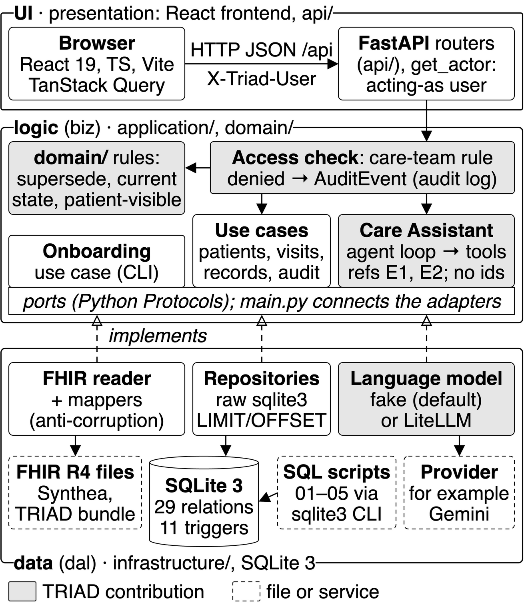

# TRIAD backend

The backend is the server of the TRIAD prototype. It has three parts:

- a FastAPI web API under `/api`. The contract of the API is [`doc/api.md`](../../doc/api.md).
- a SQLite database. The schema is [`models/relational/sql/ddl/01_create_tables.sql`](models/relational/sql/ddl/01_create_tables.sql).
- a command-line tool (`main.py`). It builds the database from the FHIR data and starts the server.

All data is synthetic. Do not put real patient data in the prototype.

## Layers

The backend uses Clean Architecture. Each layer can use only the layers below it.
Only `main.py` (the composition root) knows the concrete adapters.

```
api  ->  application  ->  domain
infrastructure  ->  application (ports) + domain
main.py  ->  all layers (it connects the adapters to the ports)
```

| Folder | Layer | Name in the course manual | What it holds |
|---|---|---|---|
| `domain/` | entities and rules | biz | Records, read models, value sets, errors. The access policy (`access.py`) and the rules (`rules.py`): the patient-visible rule, the author label, the head check, the plan visit and the clock rule. No I/O. |
| `application/` | use cases and ports | biz | One module for each area: `patients.py`, `visits.py`, `records.py`, `audit.py`, `directory.py`, `users.py`, `codes.py`, `chat/`, `assistant/`, `onboarding/`. `ports.py` holds the interfaces (Python `Protocol`) that the adapters implement. |
| `infrastructure/` | adapters | dal | `sqlite/`: the repositories and the unit of work. `fhir/`: the FHIR reader and mappers. `llm/`: the fake model and the LiteLLM model. `clock.py`, `ids.py`, `config.py`. |
| `api/` | web interface | ui | The routers, the pydantic models (camelCase JSON), the error mapping and the user header. |
| `models/` | data models | dal/models | The ER diagram (`er/`), the relations (`relational/relations.md`) and the SQL scripts (`relational/sql/`). |

The frontend (`src/frontend/`) is also part of the ui layer.

The architecture figure ([PNG](../../doc/architecture.png), [PDF](../../doc/architecture.pdf)) shows the three layers, the request path, the onboarding path and the Care Assistant.
A solid arrow is a call. A dashed arrow with an open head means that an adapter implements a port. Grey parts are the TRIAD contribution, as in the ER diagram. A dashed box is a file or a service.
The script `src/scripts/build_architecture.py` makes the figure. Its first lines give the commands that make it again.



## Why raw SQL and no ORM

- The schema in `ddl/01_create_tables.sql` is the single source of truth. An ORM would make a second copy of the schema in Python.
- The read side uses the same SQL as the report queries in `dml/03_select_queries.sql`:
  - The chart uses the current-state rule of Q1 (no assertion supersedes it).
  - The chain endpoint uses the recursive query of Q2 (`WITH RECURSIVE`).
  - The care-team check uses the logic of Q13 (Status = active, and nothing supersedes the entry).
  - The patient-visible rule is the rule of Q12. The chart query of a patient has the predicate of Q12 in its WHERE clause.
    A test shows that this predicate, `domain/rules.py` and Q12 give the same rows for each patient.
  - Each list endpoint gives one page (doc/api.md section 1.5): a `COUNT(*)` query and a query that ends with
    `ORDER BY ..., Id LIMIT ? OFFSET ?` (`infrastructure/sqlite/paging.py`). Q14 shows one page of a chart.
- The triggers and the CHECK constraints of the schema stay the last line of defense. The unit of work changes their errors into API errors (409 or 422).
- The repositories use the Python standard library `sqlite3`. Each value is a `?` parameter. Table and column names come only from fixed lists.
- The application layer uses ports, not SQL. A later ORM adapter can implement the same ports.

## How the API uses SQLite

- Each request opens one connection (`foreign_keys = ON`, `busy_timeout`). The database uses WAL mode.
- Each write starts with `BEGIN IMMEDIATE`. The access check runs before the write.
- When the rules stop an action about one patient, the backend writes an audit record (Outcome = Denied). Then it sends the 403.
- Each write gets a time that is after the latest time in the database. Thus the times always increase.
  With the computer clock (the default), the time is max(now, the latest time + 1 second).
  With a fixed `TRIAD_NOW`, the time is max(`TRIAD_NOW`, the latest time) + 1 minute (doc/api.md section 1.3).

## Install

You need Python 3.12 and [uv](https://docs.astral.sh/uv/). Run these commands from the root folder of the repository:

```sh
uv venv --python 3.12 .venv
uv pip install --python .venv/bin/python -r requirements.txt
```

The LLM chat mode needs one more package. The default mode does not need it.
See [The LLM mode](#the-llm-mode).

```sh
uv pip install --python .venv/bin/python -r requirements-llm.txt
```

## Run

The quick way: `./src/scripts/quickstart.sh` (from any folder) makes `.venv`, builds the frontend and the database, runs the fast tests and serves the app on http://127.0.0.1:8000. Add `--reset-db` to build the database again.

Build the database. The command builds it only if it is missing. It takes about 3 seconds.

```sh
.venv/bin/python src/backend/main.py ensure-db
```

To build the database again, add `--reset-db`.

Start the server on http://127.0.0.1:8000. The command runs `ensure-db` first.
The API documentation is at http://127.0.0.1:8000/docs.

```sh
.venv/bin/python src/backend/main.py serve
```

If `src/frontend/dist/` exists, the server also serves the built frontend. Each path that does not start with `/api` gets `index.html`.

For development, use `dev.sh`. It starts the API with hot reload (port 8000) and the Vite frontend (port 5173). One Ctrl+C stops both.

```sh
./src/scripts/dev.sh
./src/scripts/dev.sh --reset-db
```

The other commands of `main.py`:

| Command | What it does |
|---|---|
| `init-db` | Creates the empty schema. |
| `onboard` | Loads the FHIR data into an empty schema. |
| `export-sql` | Writes `dml/02_insert_seed.sql` (the scenario data). |

## Settings and secrets (.env)

The backend reads its settings from environment variables. The file `src/backend/.env` can hold them.
`dev.sh` makes this file from [`.env.example`](.env.example) if it is missing (mode 600). Git ignores `.env`.

- The commands of `main.py` and `create_app()` load `.env` at the start (python-dotenv).
- The order is: a variable of the shell, then `.env`, then the default. So `TRIAD_LLM=fake ./src/scripts/dev.sh` works for one run.
- An empty value in `.env` has no effect.
- After you change `.env`, start `dev.sh` again. The hot reload watches only the Python files.
- The tests do not read `.env`. They give their own settings.
- Put the API keys only in `src/backend/.env`, never in `.env.example` and never in `src/frontend/`.

| Variable | Default | What it sets |
|---|---|---|
| `TRIAD_DB_PATH` | `src/backend/data/triad.db` | The SQLite database. A relative path starts at the root folder of the repository. |
| `TRIAD_NOW` | `system` | The clock. `system` uses the clock of the computer, in its local time zone. A fixed ISO 8601 time, for example `2026-10-30T09:00:00-04:00` (`triadNow` in `data/raw/hospital_profile.json`), gives the fixed demo time. The tests, the screenshots and the report use a fixed time. |
| `TRIAD_LLM` | `fake` | The chat mode. `fake` needs no network. `llm` uses LiteLLM. |
| `TRIAD_LLM_MODEL` | `gemini/gemini-3.8-flash` | The LiteLLM model of the `llm` mode. |
| `TRIAD_SQL_LOG` | `on` | The SQL log of the API: `off`, `on` or `params`. See [The SQL log](#the-sql-log). |
| `GEMINI_API_KEY` | — | The key for the Gemini models. Only LiteLLM reads it. For another provider, use the variable of that provider (for example `ANTHROPIC_API_KEY`). |
| `PORT` | `8000` | The port of `serve` and `dev.sh`. Set it in the shell. `dev.sh` reads it before Python starts, so `.env` cannot set it for `dev.sh`. |

## The SQL log

The API logs each SQL statement of a request, with its time. `TRIAD_SQL_LOG` sets the mode: `off`, `on` (the default) or `params`.
The lines go to stderr (logger `triad.sql`). `dev.sh` shows them with the prefix `[api]`:

```text
[api] [sql] GET /api/patients/1/chart  2.28 ms  8 rows  SELECT a.Id, a.ClinicalEntryId AS EntryId, a.MessageId, ...
[api] [sql] GET /api/patients/1/chart  0.19 ms  0 rows  COMMIT
[api] [sql] GET /api/patients/1/chart 200: 10 statements, 7.0 ms in SQL, 14.4 ms in all.
```

- Each statement gets one line: the request, the time, the number of rows (read or changed) and the SQL on one line.
- The time includes all the work of the statement. The wrapper reads all the rows before it stops the timer.
- At the end of each `/api` request, one line gives the status, the number of statements, the time in SQL and the time in all.
- Only the API connections use the log (`infrastructure/sqlite/sql_log.py`). The commands of `main.py` (for example `ensure-db`) do not.
- Privacy: `on` does not show the bound values and the query string, because they can be patient names and dates of birth.
  `params` shows them. The data of TRIAD is synthetic, but a real system must not log them.
- The tests use `off`. A test that checks the log sets the mode itself.

## The LLM mode

1. Install the package: `uv pip install --python .venv/bin/python -r requirements-llm.txt`.
2. Get a Gemini API key at https://aistudio.google.com/apikey. The Gemini models have a free tier.
3. In `src/backend/.env`, set `TRIAD_LLM=llm` and `GEMINI_API_KEY=<your key>`.
4. Start `dev.sh` again. The chat shows "Mode: llm". A new chat session records the mode and the model.

For Claude, set `TRIAD_LLM_MODEL=anthropic/claude-opus-5-5` and `ANTHROPIC_API_KEY`.
For a model with a higher free-tier limit, use `gemini/gemini-3.5-flash-lite`.

- At the start, the server checks that `litellm` is installed, that the key of the model is set, and that the model can call tools
  (`litellm.supports_function_calling`). If not, it prints one line that tells what is missing, and it runs in the fake mode.
  The new sessions then show "Mode: fake". If the tool check itself fails, the server does not stop the llm mode.
- If a turn fails (for example, the free-tier limit), that turn uses the fake model, and the log gets one warning line.
  The line names only the error class, never the key.
- On the free tier, Google can use the prompts to improve its products. The data of TRIAD is synthetic.
  Do not put real patient data in the prototype.
- The free tier has a limit of requests per minute and per day. See https://aistudio.google.com/rate-limit.

**How the model selects a tool.** Each tool of `application/assistant/tools.py` has a name, a description and a JSON Schema
of its parameters (for example `get_allergies` with `substance`). LiteLLM sends them to the model with
`tools=[{"type": "function", "function": {...}}]` and `tool_choice="auto"`. The model reads the question and the descriptions,
and it gives tool calls: a name and JSON arguments (`message.tool_calls`). The backend checks each call against the schema,
runs the tool, and sends the result back as a message with `role: "tool"`. Then the model writes the answer.
The loop has at most 4 rounds (`application/assistant/agent.py`).

**The user and the patient are bound, not parameters.** The tools are closures over the user of the request (`X-Triad-User`)
and the patient of the chat session. The model cannot give a patient, a user or an id:

```python
def make_tools(ctx, actor, patient):        # actor: from the X-Triad-User header; patient: from the chat session
    def get_allergies(substance=None):      # the model calls this tool with words only
        return ctx.records.allergies(patient.id, words=words_of(substance), visible_only=actor.is_patient,
                                     limit=12)
```

- Each schema has `additionalProperties: false`. A call with an extra parameter (for example `patientId`), a wrong type or
  a bad enum value gets an error text, and no query runs.
- The tools call the repositories in the process (no HTTP call to the server). A patient gets only the patient-visible items.

**References in place of ids.** Each item of a tool result gets a reference (`E1`, `E2`, ...) for this turn only.
The backend keeps the map from the reference to `Assertion.Id`. The model sees the reference, the category, the display,
the statement, the verification, the author, the date and the subtype details. It never sees an id, the patient name,
the date of birth or an identifier. The model writes `[E1]` after each fact. The backend removes the references from the text
and cites their assertions. It drops an unknown reference. If the text has no reference, the turn cites all items of the tools.

**The fallback.** If the model fails, or it gives no final text in 4 rounds, the fake model does the turn again with the same
tools. The fake model selects one tool from the keywords of the question (`application/assistant/rule_model.py`), and the
templates of `application/assistant/answers.py` write the answer from the tool result.

## The Care Assistant

- An "ask" turn runs the loop of `application/assistant/agent.py`. The model selects the tools, and each tool is one targeted
  query (a WHERE clause on the patient and the filters, `ORDER BY`, `LIMIT 12`). No tool reads the full chart.
  The fake model and the LLM use the same tools and the same SQL. See [The LLM mode](#the-llm-mode) and `doc/api.md` section 3.5.
- The assistant cites only the assertions that the tools returned in that turn. Each card of an answer comes from one Citation row of the turn.
- The fake model knows these questions: allergies, medications, the plan, lab results, vital signs, diagnoses, visits and recommendations (for example "What did the nurse recommend?").
- A "tell" turn (a statement, not a question) goes to a fact extractor. Each fact becomes an assertion with Source = Agent and Verification = Unconfirmed, in one message with Channel = Chat. If the extractor finds no fact, the backend writes no message.
- In the `llm` mode, one more LiteLLM call extracts the facts of a "tell" turn (JSON that the code checks). If the call fails, the turn uses the fake extractor.
- Only `infrastructure/llm/litellm_client.py` imports `litellm`.

## Tests

Run the tests from the root folder of the repository:

```sh
.venv/bin/python -m pytest -q
```

| Test | What it checks |
|---|---|
| `tests/unit/test_access.py` | The permission matrix of `USER_FLOWS.md` section 2 (parametrized) and the supersede rules. |
| `tests/unit/test_rules.py` | The patient-visible rule, the author label, the head check, the plan visit and the clock. |
| `tests/unit/test_assistant.py` | Ask or tell, the intents, the tool call of the fake model and the fake fact extractor. |
| `tests/integration/test_assistant_tools.py` | Each assistant tool = the old Python selection on the full chart (Patient A, Patient B, the largest patient), no tool parameter is a patient, a user or an id, a call that is not correct runs no query, and a scripted fake `litellm`: the references and the citations, no id or patient data to the model, the patient-visible rule, the fallback and no full-chart query in a turn. |
| `tests/integration/test_hospital_visit.py` | The hospital-visit journey of `USER_FLOWS.md` section 3 (Use cases 0 to 9) through the API. |
| `tests/unit/test_settings.py` | The `.env` loader (the shell wins, empty values set nothing), the database path, the `.env.example` files (no key values) and the start check of the LLM mode. |
| `tests/integration/test_pages.py` | The pages of each list endpoint: the slices, `total`, the order, the 422 for a bad `limit` or `offset`, the chart `counts` and search, the SQL patient-visible rule = `rules.py` = Q12 for each patient, and Q14. |
| `tests/integration/test_api.py` | Q12 = the patient chart, cards = Citation rows, the denied audit records, the errors, the LLM fallback and the start check, no key text in a response, the log or the database, the directory and the speed of the chart. |
| `tests/integration/test_schema.py`, `test_onboard.py` | The SQL scripts 01 to 05 and the FHIR onboarding. |

The tests do not need the network or `litellm`. The integration tests use a copy of the database, so they do not change `data/triad.db`.

## Folders

```
src/backend/
  main.py            the composition root: the commands and create_app()
  domain/            records.py, views.py, enums.py, errors.py, access.py, rules.py
  application/       ports.py, context.py, guard.py and the use cases; chat/, assistant/, onboarding/
  infrastructure/    config.py, clock.py, ids.py; sqlite/, fhir/, llm/
  api/               app.py, actor.py, errors.py, schemas.py, routers/
  models/            er/, relational/
  data/              the FHIR source data and the database (triad.db is not in git)
  tests/             unit/, integration/
```

This backend was written with help from Claude Code (an AI tool). The team checked the code and the tests.
